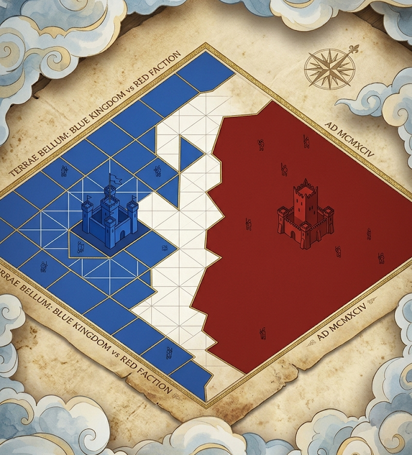
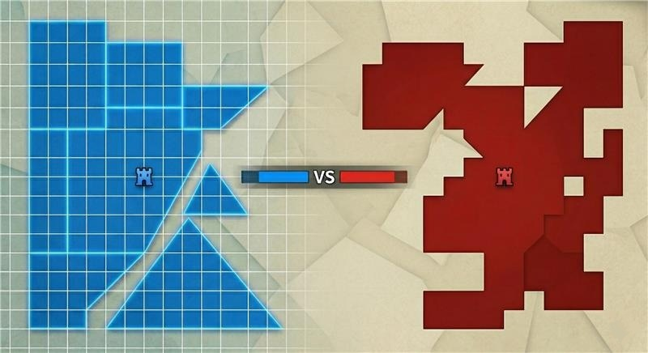
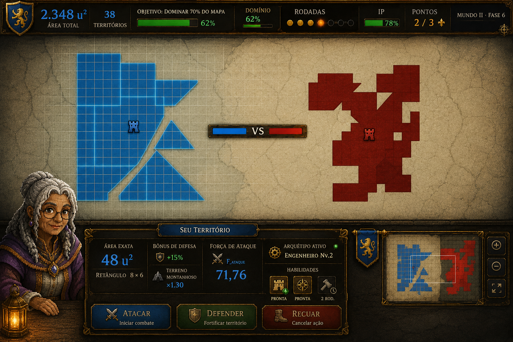
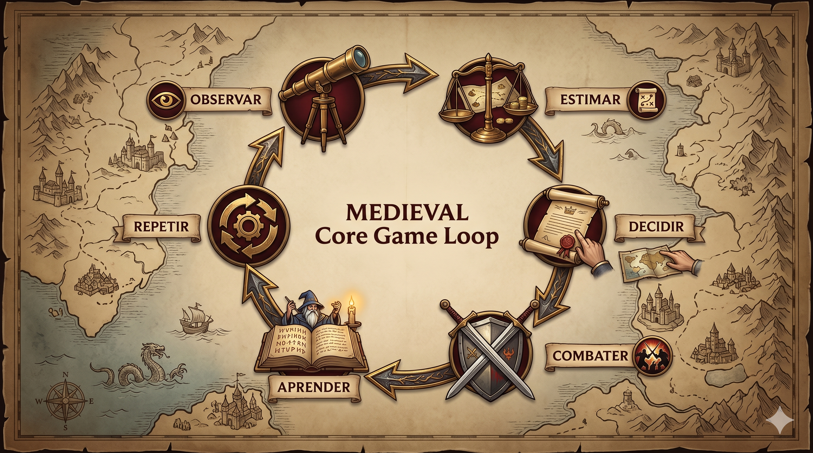
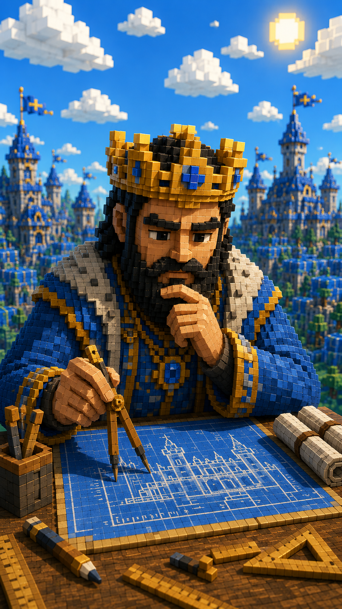
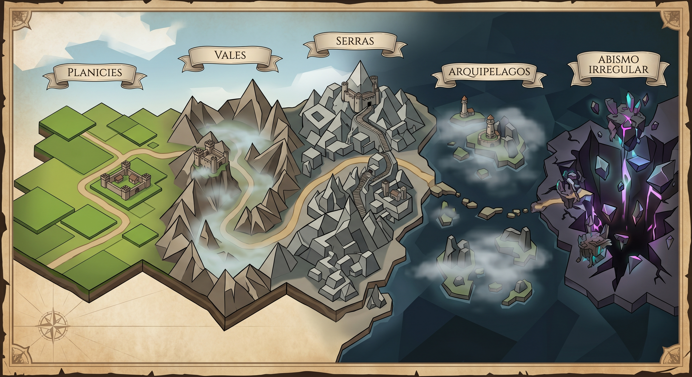
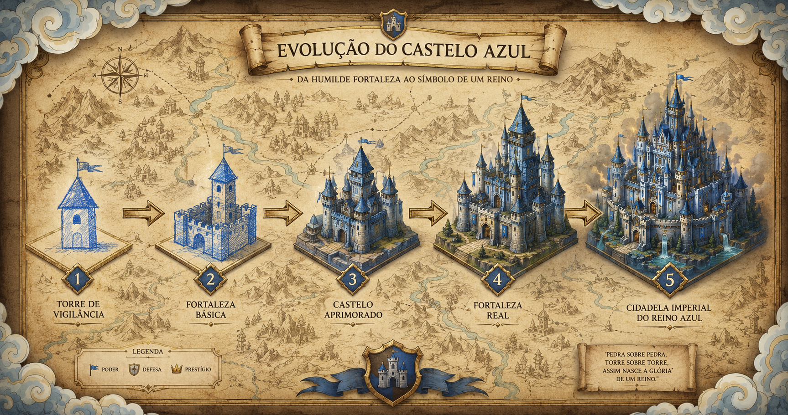

# Reinos da Área — Game Design Document (v5)



**Game Design Document · Jogo Sério · Geometria Plana**

> *Conquiste territórios. Calcule para vencer. Pense para sobreviver.*

| Gênero | Plataforma | Público | Fases |
|---|---|---|---|
| Strategy Puzzle | PC · Web | 12–16 anos | 20 fases · 5 cenários |

**Acadêmicos:** Enzo Camelo Vieira · Gabriel Luis de Santana · Bruno Faria Travessini

> **Sobre esta versão (v5).** Atualiza o GDD v4 com as decisões tomadas na implementação da N2 (protótipo v0.2). As mudanças em relação à v4 estão marcadas com **[v5]**. As principais: arquétipos do Relatório PAC IV, terreno "Vale", progressão de formas, Índice de Precisão (IP) derivado das decisões, estrelas, Recursos Estratégicos, unidades de medida progressivas, menu/mapa de campanha/tutorial e a fórmula de combate.

---

## 1. High Concept

**Reinos da Área** tem duplo significado intencional: *"reino"* evoca conquista e poder; *"área"* é tanto o conceito matemático central quanto o espaço físico disputado. Um título que carrega a essência do jogo inteiro.

**Reinos da Área** é um jogo de conquista territorial onde a força de cada ataque é determinada pela área do reino controlado. O território inimigo aparece **inteiramente visível** no mapa — porém o **grid não é exibido sobre ele**. O jogador precisa olhar para a forma do reino inimigo e estimar quantos quadrados existem ali dentro. Calcular bem significa vencer. Estimar mal significa perder território.

### Mission — Objetivos no jogo

Como o **Arquiteto-Rei**, sua missão é expandir as fronteiras do seu reino usando raciocínio geométrico como arma estratégica. Você enfrenta 10 reinos inimigos por fase, ao longo de 20 fases divididas em 5 grandes cenários medievais. Cada fase começa com uma **Área X** e o **Domínio do Mapa em 0%**.

A inovação central está na **assimetria de informação visual**: o jogador vê seu território com grid completo e área precisa, enquanto os inimigos aparecem como formas sólidas sem grid. Isso força estimativa visual e decisão sob incerteza — geometria como ferramenta estratégica real, não exercício didático explícito.



---

## 2. Visão Geral do Jogo

| | |
|---|---|
| **Gênero** | Strategy Puzzle · 4X Lite · Stealth Learning |
| **Plataforma** | PC Desktop & Web Browser |
| **Jogadores** | 1 — singleplayer |
| **Status** | **[v5]** Protótipo v0.2 jogável: menu, 3 arquétipos, mapa de campanha, 20 fases |
| **Classificação** | Livre (conteúdo educacional estratégico) |
| **Público-alvo** | 12–16 anos · 7º ano do EF ao 2º ano do EM |
| **Conteúdo** | Geometria plana · estimativa visual de área · unidades de medida |
| **Campanha** | 20 fases · 5 cenários · 10 rodadas/fase |
| **Tema sério** | Aprendizado implícito · consequência estratégica |
| **Idioma** | Português brasileiro |

---

## 3. Pilares de Design

Os objetivos de design orientam todas as decisões criativas e técnicas. Cada mecânica implementada deve servir a pelo menos um desses pilares — garantindo que o jogo nunca se torne uma prova disfarçada de matemática.

| Pilar | Descrição | Métrica |
|---|---|---|
| **01 · Aprendizado Invisível** | O jogador nunca recebe uma equação. Ele recebe uma decisão de guerra. A matemática é o instrumento; a conquista é o objetivo declarado. | Internaliza estimativa de área sem aula formal. |
| **02 · Risco com Consequência Real** | Errar uma estimativa custa território visível no mapa — feedback emocional e imediato. Nenhuma aleatoriedade anula o raciocínio correto. | 0% de aleatoriedade no resultado do combate. |
| **03 · Profundidade Emergente** | Fácil de começar, difícil de dominar. Retângulos simples evoluem para formas compostas e irregulares sob pressão de tempo. | Curva de dificuldade sem picos abruptos entre cenários. |
| **04 · Identidade Narrativa Medieval** | A fantasia de conquista justifica as regras sem cortes de cena longos. Castelos, a Cartógrafa e os reinos rivais dão peso às decisões geométricas. | Jogador nunca sente que está "estudando matemática". |
| **05 · Calibração Progressiva** | O Índice de Precisão das Estimativas gamifica o aprendizado: estimar melhor rende estrelas de ouro. | Jogadores repetem fases para melhorar o índice. |
| **06 · O que o jogo deve evitar** | Nenhuma tela de exercício explícito, nenhuma linguagem de "resposta errada", nenhuma sorte que invalide um cálculo correto. | *Nunca uma prova disfarçada de jogo.* |

**Resumo executivo:** Matemática Invisível · Risco Real · Profundidade Gradual (de retângulos a polígonos irregulares).

---

## 4. Core Gameplay — Sistema de Combate

O jogador é o **único agente ativo** no combate. Não existe turno inimigo — os reinos rivais são estáticos e aguardam a decisão do Arquiteto-Rei. O resultado depende exclusivamente da comparação entre a **Força do Jogador** e a **Força do Inimigo**, filtrada pela ação escolhida.

### As três ações

| Ação | Atalho | Aposta | Se acertar | Se errar |
|---|---|---|---|---|
| **ATACAR** | A | Meu reino é **maior**. | Vitória: Domínio +10% e área +10%. | Perde 20% da área atual. |
| **DEFENDER** | D | O inimigo é **maior**. | Vitória: Domínio +10% e área +5%. | Perde 10% da área atual. |
| **RECUAR** | R | Não tenho certeza. | — | **−3% de Domínio**; nenhum território é perdido. |

A penalidade de Recuar é deliberadamente muito menor do que errar Atacar ou Defender — incentiva agir só quando há confiança no cálculo. **Tempo esgotado** equivale a um Recuar forçado.

### Fórmula de combate **[v5]**

Uma única comparação, determinística:

```
Força do Jogador = Área_J × mult_atacante × (1 + Embalo) × Muralha
Força do Inimigo = Área_I × mult_defensor

ATACAR   vence se Força_J > Força_I
DEFENDER vence se Força_I > Força_J
```

Atacar e Defender são **complementares**: em toda rodada existe exatamente uma decisão certa; o terreno só desloca o limiar. Na Serra, por exemplo, um inimigo visivelmente 20% menor ainda "vale" mais (0,85 × Área_J contra 1,25 × Área_I) e a decisão correta é Defender.

- `mult_atacante` e `mult_defensor` vêm do terreno da rodada.
- `Embalo` é o bônus do Guerreiro (0 a +15%); `Muralha` vale ×1,25 apenas se a habilidade do Engenheiro estiver ativa.
- O gerador de territórios garante uma margem mínima de **1%** entre as duas forças, então nunca há empate.
- **Golpe Decisivo** (Guerreiro) dobra o ganho de Domínio/área em caso de vitória e dobra a perda de área em caso de derrota.

### Tabela de resultados

| Ação | Condição | Resultado |
|---|---|---|
| ATACAR | Força_J > Força_I | VITÓRIA |
| ATACAR | Força_J < Força_I | DERROTA −20% de área (−15% com Consolidação) |
| DEFENDER | Força_I > Força_J | VITÓRIA |
| DEFENDER | Força_I < Força_J | DERROTA −10% de área |
| RECUAR | qualquer | RECUO −3% de Domínio |

### Modificadores de terreno **[v5]**

Os modificadores ajustam o peso relativo das áreas comparadas; não adicionam aleatoriedade.

| Terreno | Atacante | Defensor | Onde | Efeito prático |
|---|---|---|---|---|
| **Plano** | ×1,00 | ×1,00 | Planícies (F.1–4) | Confronto puramente numérico. |
| **Vale** | ×1,00 | ×1,25 | Vales (F.5–8) | Forças menores na defesa podem vencer. |
| **Serra** | ×0,85 | ×1,25 | Serras (F.9–12) | Território elevado é mais difícil de conquistar; o inimigo "parece maior" ao defender. |
| **Costeiro** | ×1,10 | ×0,90 | Arquipélagos (F.13–16) | Atacar é mais vantajoso; exige decisão rápida (45 s). |
| **Misto** | sorteado | sorteado | Abismo (F.17–20) | A cada rodada sai um dos quatro terrenos acima, exibido no HUD. Ignorar o relevo é tão penalizante quanto errar a área. |

### Objetivo da fase

Cada fase tem **10 rodadas** contra 10 reinos inimigos. O jogador começa com Área X e Domínio 0%. O objetivo é terminar com **Domínio ≥ 70%**.

- **Vitória:** Domínio ≥ 70% ao final das 10 rodadas **[v5: a fase sempre dura as 10 rodadas]**.
- **Derrota:** Domínio < 70% ao final das 10 rodadas; área do jogador abaixo de 4 u² (rede de segurança); ou, na Fase 20, **qualquer decisão errada** (morte súbita).

---

## 5. Mecânicas — Passo a Passo

### Mecânica 1 — Seleção e resolução de ataque

1. O reino inimigo é destacado com uma **borda dourada pulsante** (0,8 s), sinalizando que a decisão está aberta.
2. Os três botões — Atacar, Defender, Recuar — ficam disponíveis na base da tela (teclas **A / D / R**).
3. O jogador escolhe uma ação; os outros botões esmaecem.
4. O sistema compara as forças em segundo plano — nenhum número é mostrado, preservando a tensão da estimativa.
5. A animação de resultado dispara: tinta azul se espalha (vitória), borda vermelha pulsa (derrota) ou ventos varrem o mapa (recuo). O Domínio é atualizado no HUD.

### Mecânica 2 — Ativação de habilidade de arquétipo **[v5]**

1. O jogador clica em **ATIVAR** (ou tecla **E**). Disponível apenas se a habilidade ainda não foi usada na fase.
2. O sistema verifica o custo. Sem **Recursos Estratégicos (RE)** suficientes, o botão vibra e fica vermelho por 0,5 s — sem outra penalidade.
3. Os RE são debitados e o contador do HUD é atualizado.
4. O efeito é aplicado à rodada (grid temporário, modificador de terreno ou dobro de ganho/perda).
5. O botão fica marcado como **USADA** até a próxima fase (1 uso por fase).

### Mecânica 3 — Avanço de rodada e fim de fase

1. O resultado é confirmado e o contador avança (ex.: 3/10 → 4/10).
2. O sistema verifica a condição de derrota imediata (área abaixo de 4 u²; erro na Fase 20).
3. Se as 10 rodadas terminaram, compara o Domínio final com 70%.
4. A **Tela de Fim de Fase** exibe estrelas, Índice de Precisão, XP e Recursos.

### Fluxo do ciclo de fase

```
Início da fase → Rodada N (1..10) → Atacar / Defender / Recuar
   → Área abaixo do mínimo (ou erro na Fase 20)?  Sim → Derrota
   → 10 rodadas concluídas?  Não → próxima rodada
   → Sim → Domínio ≥ 70%?  Sim → Vitória (estrelas)  |  Não → Derrota
```

---

## 6. Sistemas do Jogo — Arquétipos e Habilidades **[v5]**

Antes das trombetas soarem, o Rei entrega sua confiança a apenas um de três conselheiros. Cada um tem **uma passiva** e **uma ativa**. As ativas gastam **Recursos Estratégicos** e só podem ser usadas **uma vez por fase**.

| | **Estrategista** | **Engenheiro** | **Guerreiro** |
|---|---|---|---|
| Lema | Inteligência e Controle | Expansão e Fortificação | Ímpeto e Força |
| **Passiva** | **Olho de Águia** — projeta +2 células de grade ao redor do adversário como referencial visual. | **Consolidação** — o prejuízo por Atacar errado cai de 20% para 15%. | **Embalo de Combate** — +5% de área efetiva por vitória consecutiva (até +15%). Zera ao recuar ou perder. |
| **Ativa** | **Análise de Campo** (1 RE) — exibe a área real do inimigo e o grid dele por 5 s. | **Muralha de Emergência** (2 RE) — dá ao seu território o modificador de montanha (×1,25) por uma rodada. | **Golpe Decisivo** (1 RE) — dobra o ganho no sucesso, mas duplica a penalidade no revés. |
| Objetivo | Suporte analítico para quem prefere informação. | Escolhas defensivas e controle de perdas. | Alto risco e alta recompensa. |

> A passiva do Estrategista só tem efeito onde a grade de referência é limitada (Vales em diante); nas Planícies o grid já cobre todo o mapa.

### Recursos Estratégicos (RE)

- O jogador começa a campanha com **3 RE**.
- Ganha **+1 RE** ao concluir uma fase pela primeira vez.
- RE gastos não voltam, mesmo que a fase seja perdida — decidir *quando* usar a ativa é parte da estratégia.
- O medidor de RE aparece no HUD (painel de arquétipo) e no mapa de campanha.

### 6.1 Sistema de cálculo de área

O cálculo de área não é baseado em fórmulas ensinadas diretamente. O fundamento é visual e concreto: **a área de um território é o número de quadrados do grid que estão dentro dele**. Meios-blocos triangulares valem 0,5.

**Como o grid funciona.** O mapa é dividido por um grid uniforme. Cada quadrado representa uma unidade de área. O grid está sempre visível sobre o território do jogador.

**O desafio: território inimigo sem grid.** O jogador vê a forma do reino inimigo pintada de vermelho, mas precisa estimar quantos quadrados caberiam ali. A *grade de referência* ao redor do inimigo diminui com a campanha: **total** nas Planícies, **1 célula** nos Vales, **nenhuma** da Serra em diante (o Olho de Águia soma +2 células).



**Revelação pós-combate.** Após cada rodada o grid aparece sobre o inimigo com animação de "desenho à mão" (0,4 s) e permanece por 3 s. A tela informa a área real do inimigo e mostra o cálculo com os modificadores de terreno e de habilidades, por exemplo:

> *Você: 40 m² ×0,89 (atacante, Serra, Embalo) = 35,7 m² | Inimigo: 34 m² ×1,25 (defensor, Serra) = 42,5 m²* — o inimigo é visivelmente menor, mas "vale" mais; Defender era a decisão certa.

### Unidades e escalas **[v5]**

A medida acompanha o crescimento do domínio, alinhando o jogo ao ensino de grandezas:

| Cenário | Unidade | Valor de 1 bloco | Observação |
|---|---|---|---|
| Planícies (F.1–4) | m² | 1 m² | Compreensão espacial imediata. |
| Vales (F.5–8) | m² → km² | 400 m² | Muda para km² ao ultrapassar 10.000 m². |
| Serras (F.9–12) | km² | 50.000 m² | Salto de grandeza. |
| Arquipélagos e Abismo (F.13–20) | hectares | 1 ha | Medida agrária contextualizada pela narrativa. |

O HUD mostra a unidade da fase com uma indicação sutil da equivalência anterior (ex.: **2,5 km²** · *= 2.500.000 m²*). Números seguem o padrão pt-BR (milhar com ponto, decimal com vírgula).

---

## 7. Core Game Loop

**Observar → Estimar → Decidir → Combater → Aprender → Repetir.**

1. **Observação.** O jogador vê o mapa. Seu território: grid visível, área exata no HUD. O inimigo: forma inteira, sem grid. A Cartógrafa pode comentar: *"Este reino parece ocupar muitos quadrados ao norte…"*.
2. **Estimativa visual.** Observa a forma do inimigo e estima quantos quadrados cabem nela. É aqui que o aprendizado acontece de forma natural.
3. **Decisão tática.** Atacar (se acredita ser maior), Defender (se acredita que o inimigo é maior) ou Recuar (se a incerteza for alta).
4. **Resolução de combate.** O sistema compara as forças. O resultado é instantâneo e visível: o território muda de cor, o Domínio sobe ou desce, a área se ajusta. Nenhum texto de punição.
5. **Revelação e aprendizado.** O grid aparece sobre o inimigo. O Índice de Precisão atualiza. O ciclo reinicia com o próximo dos 10 reinos.



### Índice de Precisão (IP) **[v5]**

O IP é o fio pedagógico do jogo. Como o jogador **não digita estimativas** (isso viraria um exercício), ele é **derivado das decisões**. Seja *m* a margem real entre as forças, `|FJ − FI| / max(FJ, FI)`:

| Situação | IP da rodada |
|---|---|
| Decisão certa (vitória) | 100 |
| Recuo com margem < 5% (dúvida justificada) | 70 |
| Recuo com margem ≥ 5% | 40 |
| Decisão errada com margem < 5% (quase impossível de ver) | 50 |
| Decisão errada com margem < 15% | 25 |
| Decisão errada com margem ≥ 15% (diferença evidente) | 0 |

O **IP da fase** é a média das rodadas. Feedback sonoro ao final de cada rodada, sem texto de punição: IP ≥ 90 → sino cristalino curto; entre 40 e 89 → silêncio neutro; < 40 → sino grave e longo (um lembrete suave de calibração).

### Sistema de estrelas **[v5]**

Vale a insígnia mais alta conquistada.

| Insígnia | Condição |
|---|---|
| ★ **Bronze — Conclusão** | Domínio ≥ 70% ao final da rodada 10. |
| ★★ **Prata — Eficiência** | Bronze **e** atingir 70% de Domínio até a **6ª rodada** (≤ 60% das rodadas). |
| ★★★ **Ouro — Precisão** | Bronze **e** IP da fase ≥ 85% **e** nenhuma derrota. |

---

## 8. Progressão

A progressão não é linear — é uma pressão crescente: o reino do jogador cresce a cada conquista, tornando o cálculo da própria área mais complexo; e a diferença de tamanho entre jogador e inimigos diminui a cada fase, exigindo estimativas cada vez mais precisas.

**Calibração da dificuldade [v5].** O intervalo de diferença entre jogador e inimigo diminui linearmente de **25–35% na Fase 1** até **2–5% na Fase 20**. A diferença é medida na razão **efetiva** (Força_J / Força_I, já com o terreno aplicado); por isso, nos cenários com modificadores, a diferença *visível* de área engana — é o que obriga o jogador a calcular "para qual contexto" está decidindo. O tempo por rodada é fixo por cenário (60 s, 60 s, 60 s, 45 s, 30 s).

### O reino cresce e o grid encolhe

A cada vitória o jogador anexa território. O reino cresce, mas o grid mantém o tamanho da célula. Estimar a própria área fica progressivamente mais difícil: no início são 12–20 quadrados fáceis de contar; ao final, 50–65 em formas compostas e vazadas.

### Progressão de formas **[v5]**

| Cenário | Forma | Como o jogador conta |
|---|---|---|
| **I · Planícies** (F.1–4) | Retângulos simples com grande discrepância entre os lados. | Largura × altura. |
| **II · Vales** (F.5–8) | Retângulos com **meios-blocos** e **arestas diagonais**. | Contar inteiros e somar os meios-blocos; grade de referência de 1 célula. |
| **III · Serras** (F.9–12) | **Trapézios** e **formas compostas** (L, T, U). Sem grade de apoio. | Decompor e somar partes. |
| **IV · Arquipélagos** (F.13–16) | Figuras **complexas e preenchidas** com bordas diagonais. 45 s por rodada. | Decomposição sob pressão de tempo. |
| **V · Abismo** (F.17–20) | Malhas **vazadas** — blocos ausentes no interior. 30 s por rodada. | Subtração de áreas; relevo misto; Fase 20 com morte súbita. |

O jogador nunca recebe uma fórmula. Aprende geometria plana pela necessidade de sobreviver.

### A caminhada não é fácil

Nos primeiros cenários a diferença é ampla e absorve erros grosseiros. Com o avanço, essa margem desaparece e os modificadores de terreno passam a ter peso decisivo: um inimigo levemente menor em Serra (×1,25 na defesa) pode ser, na prática, maior. Saber calcular deixa de ser suficiente; é preciso saber para qual contexto se está calculando.

### Por que os arquétipos são essenciais na progressão

- **Engenheiro:** com o reino crescendo e a diferença diminuindo, a Consolidação reduz o custo dos erros ao atacar, e a Muralha de Emergência vira um seguro nos cenários de Serra em diante.
- **Guerreiro:** o Embalo de Combate é poderoso nas sequências longas, mas perder uma batalha zera o bônus. O Golpe Decisivo deve ser usado cirurgicamente, onde a estimativa é confiante — nunca como aposta.
- **Estrategista:** essencial quando a grade ao redor do inimigo some (Serras em diante). O Olho de Águia devolve parte do referencial; a Análise de Campo confirma a estimativa antes de uma decisão de alto risco.

---

## 9. Personagens

### História

No continente de Geometria, os reinos existem há séculos em equilíbrio frágil — cada um definido pela forma precisa de seu território e protegido pelas Leis da Forma. O equilíbrio se rompe quando o Grande Império das Formas Irregulares começa a absorver os reinos vizinhos, violando os tratados geométricos.

Você é o **Arquiteto-Rei**, herdeiro de um pequeno reino retangular nas Planícies de Aldrath. Seu reino é modesto, mas sua mente é afiada. Para sobreviver e contra-atacar, você precisa entender o que seus inimigos jamais compreenderam: a área de um território é sua maior arma.

### Elenco

- **O Arquiteto-Rei (jogador).** Jovem soberano, inteligente mas inexperiente. Seu arco é aprender, por necessidade, a pensar geometricamente em cada decisão de guerra.

  

- **A Cartógrafa (narradora e guia).** Anciã sábia que guia o jogador pelas fases iniciais com dicas contextuais. Voz calma, quase acadêmica, mas nunca didática.

  

- **Os Reinos Rivais (antagonistas).** Cada reino tem nome e personalidade geométrica. O Reino de Aldrasq é perfeitamente quadrado e orgulhoso de sua simetria. O Ducado de Kermith é um retângulo irregular expansionista. O **Império das Formas** é o vilão final — territórios caóticos que desafiam qualquer cálculo simples.

**Conflito central:** expandir o reino através de cálculo preciso enquanto o Império das Formas cresce caoticamente.

---

## 10. Mundo e Level Design

Geometria é o continente onde o jogo se passa — um mundo medieval-fantástico cujas fronteiras foram seladas pelas "Leis da Forma". A força de um reino vem da extensão de seu território. O continente tem 5 regiões, cada uma com atmosfera, arquitetura e formas próprias.



| # | Cenário | Fases | Terreno | Formas | Grade de referência | Tempo | Cartógrafa | Unidade |
|---|---|---|---|---|---|---|---|---|
| I | **Planícies de Aldrath** | 1–4 | Plano | Retângulos | Total | 60 s | Ativa | m² |
| II | **Vales de Kheldorn** | 5–8 | Vale | Meios-blocos e diagonais | 1 célula | 60 s | Ativa (5–6), silenciosa (7–8) | m² → km² |
| III | **Serra das Pedras Vivas** | 9–12 | Serra | Trapézios e compostas | Nenhuma | 60 s | Silenciosa (9), ausente (10+) | km² |
| IV | **Arquipélago do Oblívio** | 13–16 | Costeiro | Complexas e preenchidas | Nenhuma | **45 s** | Ausente | ha |
| V | **Abismo Irregular** | 17–20 | Misto | Malhas vazadas | Nenhuma | **30 s** | Ausente | ha |

- **I — Planícies de Aldrath.** Campos abertos, castelos de pedra simples com torres quadradas. Atmosfera de amanhecer medieval quente e acolhedora.
- **II — Vales de Kheldorn.** Vales profundos, pontes de pedra, fortalezas sobre penhascos. Névoa matinal nas montanhas; tom mais sombrio.
- **III — Serra das Pedras Vivas.** Floresta densa com castelos entre as árvores. Tom verde-escuro e opressivo. A Cartógrafa desaparece na fase 10.
- **IV — Arquipélago do Oblívio.** Ilhas conectadas por pontes de cristal. Azuis profundos e roxos — atmosfera onírica.
- **V — Abismo Irregular (o teste final).** Ruínas de uma civilização geométrica. Tom monocromático chumbo e dourado. **Fase 20: morte súbita** — errar uma decisão encerra a fase imediatamente.

### Arquitetura dos castelos

Cada reino rival tem um castelo cuja silhueta reflete sua personalidade geométrica: o Reino do Quadrado tem quatro torres idênticas; o Reino das Formas Compostas tem anexos irregulares e assimétricos. O jogador aprende a "ler" o inimigo pela arquitetura antes mesmo de ver o território.

---

## 11. Narrativa

**Contexto.** No continente de Geometria, a força de um reino não é medida por exércitos, mas pela extensão e precisão de seu território. Durante séculos, as Leis da Forma mantiveram o equilíbrio: toda disputa era resolvida pela comparação de áreas, não pelo derramamento de sangue.

**História principal.** O Grande Império das Formas Irregulares absorve reinos vizinhos, violando os tratados. Seus territórios são intencionalmente deformados — polígonos caóticos — tornando impossível aos reinos menores calcular sua força antes de um confronto. Guiado pela Cartógrafa, o Arquiteto-Rei parte em campanha pelos cinco cenários, enfrentando dez reinos por fase. Cada vitória expande seu território; cada derrota encolhe as fronteiras que jurou proteger.

**Linha do tempo da campanha:** Planícies (retângulos simples) → Vales (meios-blocos e diagonais) → Serra (trapézios e compostas) → Arquipélago (complexas) → Abismo (vazadas).

**Papéis:** o Arquiteto-Rei (do medo ao domínio); a Cartógrafa (guia os Cenários I e II e se cala até desaparecer, simbolizando a autonomia conquistada); o Império das Formas (caos geométrico a ser superado).

---

## 12. Interface (UI)

Estrutura funcional das telas centrais. A versão final aplica a direção de arte (bordas douradas, pergaminho, tipografia Cinzel/Libre Baskerville/Source Sans 3).

### Menu principal **[v5: implementado]**

Título **Reinos da Área**, lema *"Conquiste territórios. Calcule para vencer."* e os botões **Jogar Campanha · Selecionar Arquétipo · Mapa de Cenários · Opções · Sair**. Em Opções: volume de música, volume de efeitos e reinício do progresso (com confirmação). A transição para a campanha usa o pergaminho que se desdobra.

### Seleção de arquétipo **[v5]**

Três cartões (Estrategista, Engenheiro, Guerreiro) com passiva, ativa, custo em RE e objetivo.

### Mapa de campanha **[v5]**

Cinco colunas (cenários) com quatro fases cada. Cada fase mostra estrelas ou cadeado. Ao selecionar uma fase abre o **briefing**: terreno, tempo, formas, grade de referência, unidade, estado da Cartógrafa, melhor resultado e troca de conselheiro. Mostra o contador de RE.

### Tela de jogo — HUD principal

- **Barra superior:** área total (na unidade da fase), barra de Domínio com meta de 70%, 10 marcadores de rodada, Mundo/Fase e terreno.
- **Painel inferior, esquerda:** terreno da rodada, sequência de vitórias, tempo, força de ataque e de defesa (já com os modificadores) e Precisão.
- **Painel inferior, centro:** botões **ATACAR [A] · DEFENDER [D] · RECUAR [R]**; após a decisão, o resultado, o cálculo e **PRÓXIMA RODADA**.
- **Painel inferior, direita:** arquétipo ativo, passiva, ativa (botão **ATIVAR**, tecla E) e medidor de RE.
- **Cartógrafa:** retrato e balão de fala sobre o mapa, conforme a fase.


### Tela de fim de fase **[v5: implementado]**

Insígnias (bronze/prata/ouro) que se acendem em sequência (1,5 s), **Índice de Precisão**, Domínio final, vitórias/derrotas/recuos, **XP** e **Recursos**. Botões: **Repetir Fase**, **Próxima Fase**, **Mapa**.

### Tutorial **[v5]**

Na primeira vez na Fase 1, a Cartógrafa conduz 5 passos (seu grid, o inimigo sem grid, os botões, o custo dos erros e a revelação), com opção **Pular**. O relógio fica pausado durante o tutorial.

### Controles **[v5]**

| Tecla | Ação |
|---|---|
| **A** | Atacar |
| **D** | Defender |
| **R** | Recuar |
| **E** | Ativar habilidade |
| **Enter / Espaço** | Próxima rodada (na tela de resultado) |
| **Esc** | Voltar ao mapa |

---

## 13. Direção de Arte

### Estilo visual

A estética nasce da intersecção entre a cartografia medieval iluminada do século XIII — bordas douradas, pergaminhos texturizados, caligrafia serifada — e o design limpo e legível de estratégias modernas como *Into the Breach* e *Slay the Spire*. O resultado parece antigo, mas funciona como contemporâneo.

O mapa é o protagonista visual. Fronteiras são traços dourados. A transição entre territórios conquistados e não conquistados é uma animação de "tinta se espalhando" pelo pergaminho.

### Castelos e arquitetura medieval

Cada reino possui um ícone de castelo estilizado em pixel art. O castelo do jogador começa como um humilde *keep* normando e evolui com o reino: torres surgem, muralhas se expandem, bandeiras aparecem nas ameias. Os castelos rivais refletem a personalidade geométrica de cada reino.



*(A evolução visual do castelo é meta de arte futura; o protótipo v0.2 usa o brasão e o castelo-ícone estáticos.)*

### Tipografia

| Uso | Fonte |
|---|---|
| Display / Títulos | **Cinzel** |
| Corpo / textos narrativos | **Libre Baskerville** |
| Interface / HUD | **Source Sans 3** |

### Princípios de animação

- **Conquista:** tinta azul se espalha pelo novo território (0,6 s, ease-out).
- **Derrota:** borda vermelha pulsante por 2 s.
- **Revelação:** grid aparece sobre o inimigo com efeito de "desenho à mão" (0,4 s).
- **Castelo:** animação de construção ao atingir novo nível de área *(futuro)*.

**Referências:** Civilization VI · Risk · Territorial.io · War · Clash of Clans · Into the Breach · Crusader Kings.

---

## 14. Animações

Como não há personagens com locomoção livre, a lista cobre territórios, castelo, UI e retratos. Todas as animações principais são **procedurais** (código/Tween), sem sprite sheets.

| Animação | Objeto | Descrição | Duração | Prioridade | Estado |
|---|---|---|---|---|---|
| Idle retrato | Cartógrafa | Leve respiração e piscar no retrato | Loop 2,5 s | Baixa | Futuro |
| Idle castelo | Castelo do jogador | Bandeira ondulando, fumaça nas torres | Loop 3 s | Baixa | Futuro |
| Seleção de território | Reino inimigo | Borda dourada pulsante | Loop 0,8 s | Alta | ✅ |
| Conquista | Território | Tinta azul se espalha sobre o território conquistado | 0,6 s | Alta | ✅ |
| Derrota | Território do jogador | Borda vermelha pulsante + partículas "X" | 2 s | Alta | ✅ |
| Recuo | Mapa | Linhas de vento varrem o mapa | ~1 s | Média | ✅ |
| Revelação de grid | Território inimigo | Grid surge com efeito de "desenho à mão" | 0,4 s + 3 s | Alta | ✅ |
| Entrada do inimigo | Território inimigo | Surge por varredura de colunas entre rodadas | ~0,9 s | Média | ✅ |
| Evolução do castelo | Castelo do jogador | Novas torres/muralhas | 1,2 s | Média | Futuro |
| Uso de habilidade | Botão de arquétipo | Brilho dourado no botão (ou vibração vermelha sem recursos) e aviso na tela | 0,5 s | Média | ✅ |
| Transição de fase | Mapa / tela | Pergaminho "vira a página" | 0,9 s | Média | ✅ |
| Menu → campanha | Tela | Pergaminho se desdobra | 0,9 s | Média | ✅ |
| Conquista de estrela | Fim de fase | Estrelas preenchem com brilho sequencial | 1,5 s | Baixa | ✅ |
| Hover/press de botão | Botões | Realce dourado ao passar o cursor (troca imediata de estilo; sem interpolação ainda) | 0,15 s (meta) | Baixa | ⚠️ parcial |

---

## 15. Áudio

O design de áudio segue a mesma filosofia: medieval por estética, moderno por função. O jogador deve entender o estado do jogo mesmo de olhos fechados.

- **Trilha sonora.** Orquestra de câmara medieval: alaúde e violas de gamba na exploração; percussão crescente de tambores durante a análise; fanfarra de trompas nas vitórias; melodia descendente nas derrotas. Meta: tema próprio por cenário *(futuro; o protótipo usa uma trilha única)*.
- **Efeitos sonoros.** Pergaminho ao desdobrar mapa e virar página; choque de espadas e escudos nas decisões; arco esticando no hover e flecha ao clicar; "batidas de guerra" nos últimos 10 s do relógio; sinos de precisão (ver §7).
- **Ambientação sonora** *(futuro)*: vento e pássaros nas Planícies; eco de montanha nos Vales; folhagem na Serra; ondas no Arquipélago; quase silêncio no Abismo.
- **Narrativa sonora da Cartógrafa** *(futuro: voz)*. Deve soar como uma avó sábia, nunca como uma professora. Exemplos usados hoje em texto:
  - *"Este reino parece largo, mas não tão alto… decida com cuidado, Arquiteto."*
  - *"Você era maior do que pensava. Da próxima vez, observe mais de perto antes de recuar."*
- **Infraestrutura [v5].** `AudioManager` (autoload) com buses **Music** e **SFX** independentes e volumes salvos no progresso.

### Feedback sonoro da precisão

| Faixa | Som |
|---|---|
| IP da rodada ≥ 90 | Sino cristalino, curto e agradável. |
| 40 ≤ IP < 90 | Silêncio neutro — o jogador aprende visualmente. |
| IP < 40 | Sino grave e longo; lembrete suave, não punitivo. |

---

## 16. Inteligência Artificial

Não há inimigos com movimento ou ataque ativo; o desafio nasce da estimativa visual. Dois agentes operam por máquinas de estado finito (FSM).

### FSM — Reino inimigo *(futuro)*

Quatro estados visuais, puramente cosméticos (cor da borda): **Estável** (não enfrentado) → **Em Alerta** (jogador venceu a anterior) → **Vulnerável** (área < jogador) → **Conquistado**. Nenhum altera o cálculo de área, sempre determinístico.

### FSM — Cartógrafa **[v5: implementado]**

Fixa por fase (não condicional ao desempenho), para que todos enfrentem a mesma autonomia:

| Estado | Fases | Comportamento |
|---|---|---|
| **Presente · Ativa** | 1–6 | Comenta a forma do inimigo antes de cada rodada e reage ao resultado. |
| **Presente · Silenciosa** | 7–9 | Só comenta nas derrotas. |
| **Ausente** | 10 em diante | Nenhuma dica; o jogador depende da própria leitura. |

---

## 17. Gameplay Example

**Fase 15 — Arquipélago do Oblívio.** Sem grade de referência. Unidade: hectares. O jogador inicia com **48 ha** (= 480.000 m²) e **Domínio 62%** na 4ª rodada. Terreno Costeiro: atacante ×1,10, defensor ×0,90.

1. **Observação.** O HUD mostra "48 ha · Domínio 62% · Rodada 4/10". O território do jogador exibe o grid azul. O inimigo é um polígono vermelho sem grid. A Cartógrafa está ausente.
2. **Estimativa.** O jogador observa o polígono e estima os blocos, lembrando que atacar dá ×1,10 ao seu lado e ×0,90 ao inimigo.
3. **Decisão.** Acredita ser maior mesmo com a margem do terreno: **ATACAR**.
4. **Resolução.** O sistema compara as forças. A tinta azul se espalha sobre o vermelho. Domínio sobe de 62% para 72%. O HUD mostra o cálculo: *Você: 48 ha ×1,10 = 52,8 ha | Inimigo: 44 ha ×0,90 = 39,6 ha*.
5. **Revelação.** O grid surge sobre o território conquistado e o jogador confere a estimativa. O IP daquela rodada é 100.

**O aprendizado oculto.** O jogador descobre sozinho que a área de uma figura composta se obtém por decomposição, e que o contexto (terreno) pondera a área. Não houve instrução — houve necessidade estratégica.

---

## 18. Tema e Aspecto Sério

**Tema abordado.** Geometria plana aplicada à estimativa de área: raciocínio espacial e estimativa visual sem instrução explícita, mais **unidades de medida de área** (m², km², hectares). A progressão parte de retângulos (Cenário 1) e avança para meios-blocos e diagonais (2), trapézios e compostas (3), complexas (4) e malhas vazadas (5).

**Como aparece no jogo.** A geometria nunca é nomeada como tal: calcular área equivale a ter poder militar; errar a estimativa significa perder território. O jogador estima, age, erra e aprende pela revelação pós-combate — e na próxima situação análoga estima melhor.

**Aprendizado por indução.** O jogador descobre que a área de um retângulo é largura × altura porque precisa disso para vencer. Em formas compostas aprende decomposição; nas vazadas, subtração de áreas. Com os modificadores de terreno, desenvolve raciocínio proporcional.

| Integração aprendizado × gameplay |
|---|
| Raciocínio geométrico emerge por necessidade estratégica |
| Erros têm consequência emocional e visual imediata |
| O Índice de Precisão quantifica a evolução |
| A revelação pós-combate fecha o ciclo de aprendizagem |
| Terreno e escalas de medida introduzem raciocínio proporcional |
| Nenhuma tela de exercício explícito, nenhuma linguagem de "resposta errada" |

**Princípio central:** o jogo nunca pode funcionar como uma prova disfarçada.

**Literatura de jogos sérios.** O design segue a aprendizagem baseada em jogos (Gee, 2003): contexto significativo, consequência das ações e ciclos de feedback imediato. A progressão — de formas regulares a polígonos irregulares sob pressão de tempo — respeita a Teoria da Carga Cognitiva (Sweller, 1988), introduzindo complexidade somente quando a habilidade anterior está consolidada.

---

## Apêndice — O que mudou da v4 para a v5

| Tema | v4 | v5 |
|---|---|---|
| Arquétipos | Fortificações/Espólios, Legião de Cativos/Aço Duplo, Infiltração Noturna/Cartografia Roubada | Consolidação/Muralha, Embalo/Golpe Decisivo, Olho de Águia/Análise de Campo, com custo em RE |
| Terrenos | Plano, Serra, Costeiro | Acrescenta **Vale** e o relevo **Misto** do Abismo |
| Formas | Quinas irregulares → L/T → diagonais → polígonos de até 12 lados | Meios-blocos/diagonais → trapézios e compostas → complexas → malhas vazadas |
| Fim de fase | "Domínio ≥ 70% ao final das 10 rodadas" com Prata "≤ 60% das rodadas" (inconsistente) | Sempre 10 rodadas; Prata = 70% até a rodada 6 |
| Índice de Precisão | Descrito sem fórmula | Derivado das decisões (tabela em §7) |
| Unidades | u² | m², km², hectares |
| Telas | Wireframes | Menu, arquétipo, mapa, fim de fase e tutorial implementados |
| Recuo | −3% de Domínio (GDD) / −5% de área (protótipo v0.1) | −3% de Domínio, sem perda de área |
