# Reinos da Área — Game Design Document (v6)

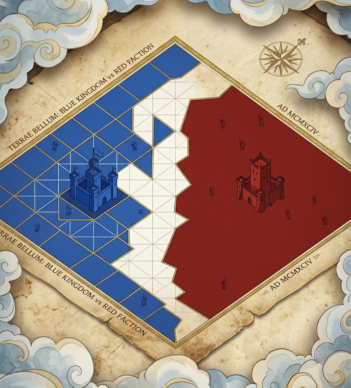

**Game Design Document · Jogo Sério · Geometria Plana**

> *Conquiste territórios. Calcule para vencer. Pense para sobreviver.*

| Gênero | Plataforma | Público | Fases |
|---|---|---|---|
| Strategy Puzzle | PC · Web | 12–16 anos | 20 fases · 5 cenários |

**Acadêmicos:** Enzo Camelo Vieira

> **Sobre esta versão (v6, novembro de 2026).** Descreve o jogo como ele está no código. As mudanças em relação à v5 estão marcadas com **[v6]** (as marcas **[v5]** foram mantidas). Principais: medalhas pelo Domínio e trava de terreno por estrelas, rodadas mais curtas, relatório pós-rodada, história e guia dentro do jogo, mapa de campanha com trilha e saltos no Abismo, e a documentação de sistemas que já existiam no código (pontuação, geração de territórios, telas, salvamento). O Apêndice lista o histórico de mudanças.

---

## 1. High Concept

**Reinos da Área** tem duplo significado intencional: *"reino"* evoca conquista e poder; *"área"* é tanto o conceito matemático central quanto o espaço físico disputado. Um título que carrega a essência do jogo inteiro.

**Reinos da Área** é um jogo de conquista territorial onde a força de cada ataque é determinada pela área do reino controlado. O território inimigo aparece **inteiramente visível** no mapa — porém o **grid não é exibido sobre ele**. O jogador precisa olhar para a forma do reino inimigo e estimar quantos quadrados existem ali dentro. Calcular bem significa vencer. Estimar mal significa perder território.

### Mission — Objetivos no jogo

Como o **Arquiteto-Rei**, sua missão é expandir as fronteiras do seu reino usando raciocínio geométrico como arma estratégica. Você enfrenta 10 reinos inimigos por fase, ao longo de 20 fases divididas em 5 grandes cenários medievais. Cada fase começa com uma **Área X** e o **Domínio do Mapa em 0%**.

A inovação central está na **assimetria de informação visual**: o jogador vê seu território com grid completo e área precisa, enquanto os inimigos aparecem como formas sólidas sem grid. Isso força estimativa visual e decisão sob incerteza — geometria como ferramenta estratégica real, não exercício didático explícito.

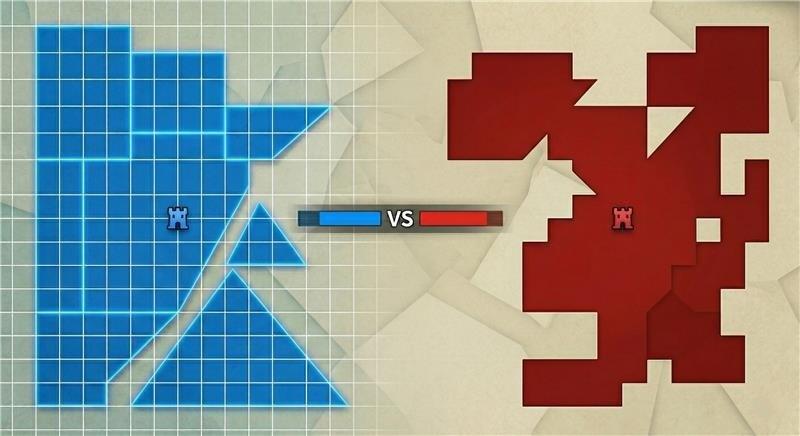

---

## 2. Visão Geral do Jogo

| | |
|---|---|
| **Gênero** | Strategy Puzzle · 4X Lite · Stealth Learning |
| **Plataforma** | PC Desktop (meta: também Web). **[v6]** O protótipo é distribuído para Windows; a versão Web ainda não existe |
| **Jogadores** | 1 — singleplayer |
| **Status** | **[v6]** Protótipo v0.2 jogável: campanha de 20 fases, 3 arquétipos, história, tutorial, guia e relatório pós-rodada |
| **Classificação** | Livre (conteúdo educacional estratégico) |
| **Público-alvo** | 12–16 anos · 7º ano do EF ao 2º ano do EM |
| **Conteúdo** | Geometria plana · estimativa visual de área · unidades de medida |
| **Campanha** | 20 fases · 5 cenários · 10 rodadas/fase |
| **Tema sério** | Aprendizado implícito · consequência estratégica |
| **Idioma** | Português brasileiro |

---

## 3. Pilares de Design

Os objetivos de design orientam todas as decisões criativas e técnicas. Cada mecânica implementada deve servir a pelo menos um desses pilares — garantindo que o jogo nunca se torne uma prova disfarçada de matemática.

| Pilar | Descrição | Métrica |
|---|---|---|
| **01 · Aprendizado pela Decisão** **[v6]** | Na hora de decidir, o jogador não recebe exercício nem conta pronta: recebe uma decisão de guerra. O cálculo é ensinado como estratégia (lições da Cartógrafa e guia) e explicado depois da decisão (relatório). | Internaliza estimativa de área sem aula formal. |
| **02 · Risco com Consequência Real** | Errar uma estimativa custa território visível no mapa — feedback emocional e imediato. Nenhuma aleatoriedade anula o raciocínio correto. | 0% de aleatoriedade no resultado do combate. |
| **03 · Profundidade Emergente** | Fácil de começar, difícil de dominar. Retângulos simples evoluem para formas compostas e irregulares sob pressão de tempo. | Curva de dificuldade sem picos abruptos entre cenários. |
| **04 · Identidade Narrativa Medieval** | A fantasia de conquista justifica as regras. A história aparece em cenas curtas e puláveis; a Cartógrafa e os reinos rivais dão peso às decisões geométricas. | Jogador nunca sente que está "estudando matemática". |
| **05 · Calibração Progressiva** **[v6]** | Medalhas pelo Domínio e trava de terreno incentivam repetir fases; o Índice de Precisão mostra a qualidade das decisões. | Jogadores repetem fases para melhorar a medalha. |
| **06 · O que o jogo deve evitar** | Nenhuma tela de exercício, nenhuma linguagem punitiva (o relatório diz o que aconteceu e como calcular), nenhuma sorte que invalide um cálculo correto. | *Nunca uma prova disfarçada de jogo.* |

**Resumo executivo:** Matemática em Ação · Risco Real · Profundidade Gradual (de retângulos a polígonos irregulares).

---

## 4. Core Gameplay — Sistema de Combate

O jogador é o **único agente ativo** no combate. Não existe turno inimigo — os reinos rivais são estáticos e aguardam a decisão do Arquiteto-Rei. O resultado depende exclusivamente da comparação entre a **Força do Jogador** e a **Força do Inimigo**, filtrada pela ação escolhida.

### As três ações

| Ação | Atalho | Aposta | Se acertar | Se errar |
|---|---|---|---|---|
| **ATACAR** | A | Meu reino é **maior**. | Vitória: Domínio +10% e área +10%. | Perde 20% da área atual. |
| **DEFENDER** | D | O inimigo é **maior**. | Vitória: Domínio +10% e área +5%. | Perde 10% da área atual. |
| **RECUAR** | R | Não tenho certeza. | — | **−3% de Domínio**; nenhum território é perdido. |

A penalidade de Recuar é deliberadamente muito menor do que errar Atacar ou Defender — incentiva agir só quando há confiança no cálculo. **Tempo esgotado** equivale a um Recuar forçado.

### Fórmula de combate **[v5]**

Uma única comparação, determinística:

```
Força do Jogador = Área_J × mult_atacante × (1 + Embalo) × Muralha
Força do Inimigo = Área_I × mult_defensor

ATACAR   vence se Força_J > Força_I
DEFENDER vence se Força_I > Força_J
```

Atacar e Defender são **complementares**: em toda rodada existe exatamente uma decisão certa; o terreno só desloca o limiar. Na Serra, por exemplo, um inimigo visivelmente 20% menor ainda "vale" mais (0,85 × Área_J contra 1,25 × Área_I) e a decisão correta é Defender.

- `mult_atacante` e `mult_defensor` vêm do terreno da rodada.
- `Embalo` é o bônus do Guerreiro (0 a +15%); `Muralha` vale ×1,25 apenas se a habilidade do Engenheiro estiver ativa.
- O gerador de territórios garante uma margem mínima de **1%** entre as duas forças, então nunca há empate.
- **Golpe Decisivo** (Guerreiro) dobra o ganho de Domínio/área em caso de vitória e dobra a perda de área em caso de derrota.

### Tabela de resultados

| Ação | Condição | Resultado |
|---|---|---|
| ATACAR | Força_J > Força_I | VITÓRIA |
| ATACAR | Força_J < Força_I | DERROTA −20% de área (−15% com Consolidação) |
| DEFENDER | Força_I > Força_J | VITÓRIA |
| DEFENDER | Força_I < Força_J | DERROTA −10% de área |
| RECUAR | qualquer | RECUO −3% de Domínio |

### Modificadores de terreno **[v5]**

Os modificadores ajustam o peso relativo das áreas comparadas; não adicionam aleatoriedade.

| Terreno | Atacante | Defensor | Onde | Efeito prático |
|---|---|---|---|---|
| **Plano** | ×1,00 | ×1,00 | Planícies (F.1–4) | Confronto puramente numérico. |
| **Vale** | ×1,00 | ×1,25 | Vales (F.5–8) | Forças menores na defesa podem vencer. |
| **Serra** | ×0,85 | ×1,25 | Serras (F.9–12) | Território elevado é mais difícil de conquistar; o inimigo "parece maior" ao defender. |
| **Costeiro** | ×1,10 | ×0,90 | Arquipélagos (F.13–16) | Atacar é mais vantajoso; exige decisão rápida (30 s). |
| **Misto** | sorteado | sorteado | Abismo (F.17–20) | A cada rodada sai um dos quatro terrenos acima, exibido no HUD. Ignorar o relevo é tão penalizante quanto errar a área. |

### Objetivo da fase

Cada fase tem **10 rodadas** contra 10 reinos inimigos. O jogador começa com Área X e Domínio 0%. O objetivo é terminar com **Domínio ≥ 60%**.

- **Vitória:** Domínio ≥ 60% ao final das 10 rodadas **[v5: a fase sempre dura as 10 rodadas]**.
- **Derrota:** Domínio < 60% ao final das 10 rodadas; área do jogador abaixo de 4 u² (rede de segurança); ou, na Fase 20, **qualquer decisão errada** (morte súbita).

---

## 5. Mecânicas — Passo a Passo

### Mecânica 1 — Seleção e resolução de ataque

1. **[v6]** A rodada começa com cerca de 0,8 s de observação (botões travados; o relógio já corre). Depois o reino inimigo ganha uma **borda dourada pulsante** (ciclo de 0,8 s): a decisão está aberta.
2. Os três botões — Atacar, Defender, Recuar — ficam disponíveis na base da tela (teclas **A / D / R**).
3. O jogador escolhe uma ação; os outros botões esmaecem.
4. O sistema compara as forças em segundo plano — nenhum número é mostrado, preservando a tensão da estimativa.
5. A animação de resultado dispara cerca de 1 s depois: tinta azul se espalha (vitória), borda vermelha pulsa e a tela treme (derrota) ou ventos varrem o mapa (recuo). Selo grande de resultado e valores flutuantes mostram o efeito no Domínio e na área.
6. **[v6]** 1,4 s depois abre o **relatório pós-rodada** (§6.2).

### Mecânica 2 — Ativação de habilidade de arquétipo **[v5]**

1. O jogador clica no botão da habilidade (ou tecla **E**) durante a observação ou a decisão. Disponível apenas se ela ainda não foi usada na fase.
2. O sistema verifica o custo. Sem **Recursos Estratégicos (RE)** suficientes, o botão vibra e fica vermelho por 0,5 s — sem outra penalidade.
3. Os RE são debitados e o contador do HUD é atualizado.
4. O efeito é aplicado à rodada (grid temporário, modificador de terreno ou dobro de ganho/perda).
5. O botão fica marcado como **USADA** até a próxima fase (1 uso por fase).

### Mecânica 3 — Avanço de rodada e fim de fase

1. O resultado é confirmado e o contador avança (ex.: 3/10 → 4/10).
2. O sistema verifica a condição de derrota imediata (área abaixo de 4 u²; erro na Fase 20).
3. Se as 10 rodadas terminaram, compara o Domínio final com 60%.
4. A **Tela de Fim de Fase** exibe medalha, Domínio, Índice de Precisão, XP, Recursos e o desfecho da história.

### Fluxo do ciclo de fase

```
Início da fase → Rodada N (1..10) → Atacar / Defender / Recuar
   → Área abaixo do mínimo (ou erro na Fase 20)?  Sim → Derrota
   → 10 rodadas concluídas?  Não → próxima rodada
   → Sim → Domínio ≥ 60%?  Sim → Vitória (estrelas)  |  Não → Derrota
```

---

## 6. Sistemas do Jogo — Arquétipos e Habilidades **[v5]**

Antes das trombetas soarem, o Rei entrega sua confiança a apenas um de três conselheiros. Cada um tem **uma passiva** e **uma ativa**. As ativas gastam **Recursos Estratégicos** e só podem ser usadas **uma vez por fase**.

| | **Estrategista** | **Engenheiro** | **Guerreiro** |
|---|---|---|---|
| Lema | Inteligência e Controle | Expansão e Fortificação | Ímpeto e Força |
| **Passiva** | **Olho de Águia** — projeta +2 células de grade ao redor do adversário como referencial visual. | **Consolidação** — o prejuízo por Atacar errado cai de 20% para 15%. | **Embalo de Combate** — +5% de área efetiva por vitória consecutiva (até +15%). Zera ao recuar ou perder. |
| **Ativa** | **Análise de Campo** (1 RE) — revela o grid do inimigo por 5 s, sem informar o valor da área. | **Muralha de Emergência** (2 RE) — dá ao seu território o modificador de montanha (×1,25) por uma rodada. | **Golpe Decisivo** (1 RE) — dobra o ganho no sucesso, mas duplica a penalidade no revés. |
| Objetivo | Suporte analítico para quem prefere informação. | Escolhas defensivas e controle de perdas. | Alto risco e alta recompensa. |

> A passiva do Estrategista só tem efeito onde a grade de referência é limitada (Vales em diante); nas Planícies o grid já cobre todo o mapa.

### Recursos Estratégicos (RE)

- O jogador começa a campanha com **3 RE**.
- Ganha **+1 RE por medalha nova** em cada fase (Ouro de primeira = +3; melhorar a medalha depois paga a diferença).
- RE gastos não voltam, mesmo que a fase seja perdida — decidir *quando* usar a ativa é parte da estratégia.
- O medidor de RE aparece no HUD (painel de arquétipo) e no mapa de campanha.

### 6.1 Sistema de cálculo de área

**[v6]** O fundamento é visual e concreto (os atalhos de cálculo são apresentados nas lições, no guia e no relatório): **a área de um território é o número de quadrados do grid que estão dentro dele**. Meios-blocos triangulares valem 0,5.

**Como o grid funciona.** O mapa é dividido por um grid uniforme. Cada quadrado representa uma unidade de área. O grid está sempre visível sobre o território do jogador.

**O desafio: território inimigo sem grid.** O jogador vê a forma do reino inimigo pintada de vermelho, mas precisa estimar quantos quadrados caberiam ali. A *grade de referência* ao redor do inimigo diminui com a campanha: **total** nas Planícies, **1 célula** nos Vales, **nenhuma** da Serra em diante (o Olho de Águia soma +2 células).

**Revelação pós-combate.** Após cada rodada o grid aparece sobre o inimigo com animação de "desenho à mão" (0,4 s) e **[v6]** permanece visível até a próxima rodada.

### Unidades e escalas **[v5]**

A medida acompanha o crescimento do domínio, alinhando o jogo ao ensino de grandezas:

| Cenário | Unidade | Valor de 1 bloco | Observação |
|---|---|---|---|
| Planícies (F.1–4) | m² | 1 m² | Compreensão espacial imediata. |
| Vales (F.5–8) | m² → km² | 400 m² | Muda para km² ao ultrapassar 10.000 m². |
| Serras (F.9–12) | km² | 50.000 m² | Salto de grandeza. |
| Arquipélagos e Abismo (F.13–20) | hectares | 1 ha | Medida agrária contextualizada pela narrativa. |

O HUD mostra a unidade da fase com uma indicação sutil da equivalência anterior (ex.: **2,5 km²** · *= 2.500.000 m²*). Números seguem o padrão pt-BR (milhar com ponto, decimal com vírgula).

### 6.2 Relatório pós-rodada **[v6]**

Um popup compara os dois reinos **lado a lado**: miniatura com grade e medidas, passo a passo do cálculo, área na unidade da fase, multiplicador (terreno, Embalo, Muralha) e força. Abaixo, a comparação das forças, a decisão certa, a escolha do jogador, o efeito em Domínio e área, a nota de precisão da rodada e a fala da Cartógrafa (quando ela está presente). **V** esconde o relatório para ver o campo; **Enter** avança.

O método de cálculo é escolhido pela forma desenhada:

| Forma | Como o relatório explica |
|---|---|
| Retângulo | base × altura |
| Trapézio (em pé ou deitado) | (B + b) × h ÷ 2 |
| Cantos cortados, L, T, U ou poucos buracos (até 3 recortes retangulares) | retângulo em volta − recortes − meios-blocos × ½ |
| Irregular | blocos inteiros + meios-blocos × ½, com a soma linha a linha ao lado do desenho |

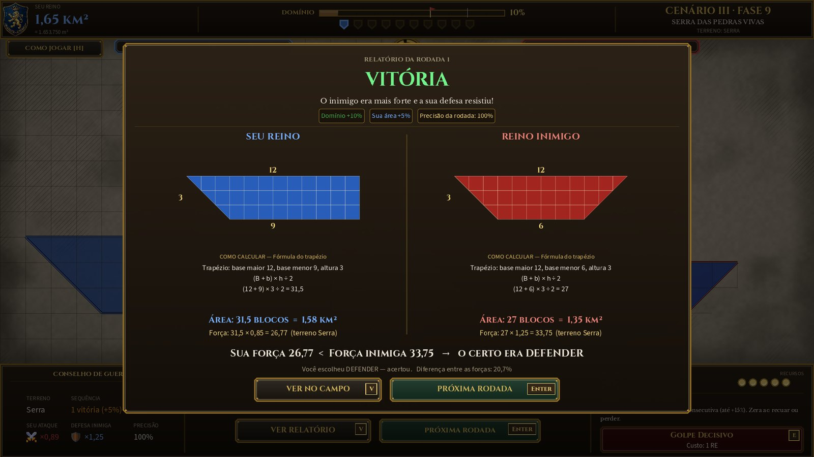

> Exemplo real (Fase 9, Serra): *Você: 31,5 × 0,85 = 26,77 · Inimigo: 27 × 1,25 = 33,75.* O inimigo é menor, mas "vale" mais; Defender era a decisão certa.

### 6.3 Territórios: geração e limites **[v6]**

- **Campo:** 32 × 13 blocos, metade para cada reino.
- **Área inicial** sorteada por cenário (tabela em §8). Durante a fase, a área do jogador passa de uma rodada para a outra com os ganhos e perdas (máximo de 100 blocos; abaixo de 4 a fase termina). Cada fase começa com uma nova área inicial.
- A cada rodada os dois reinos recebem **formas novas** (posição e orientação variam); o seu é redesenhado com área próxima da acumulada.
- **Formas:** retângulos com lados bem diferentes; retângulos com 1 a 4 cantos cortados; trapézios (60%) ou formas em L, T e U (40%); figuras orgânicas preenchidas com bordas diagonais; e figuras com 1 a 3 buracos.
- **Tamanho do inimigo:** definido pela razão entre as **forças**, dentro da diferença da fase, com 50% de chance de ser o mais forte. O sorteio gera o cenário; o resultado do combate é sempre determinístico.

---

## 7. Core Game Loop

**Observar → Estimar → Decidir → Combater → Aprender → Repetir.**

1. **Observação.** O jogador vê o mapa. Seu território: grid visível, área exata no HUD. O inimigo: forma inteira, sem grid. A Cartógrafa pode comentar: *"Este reino parece amplo. Observe bem sua forma antes de agir."*.
2. **Estimativa visual.** Observa a forma do inimigo e estima quantos quadrados cabem nela. É aqui que o aprendizado acontece de forma natural.
3. **Decisão tática.** Atacar (se acredita ser maior), Defender (se acredita que o inimigo é maior) ou Recuar (se a incerteza for alta).
4. **Resolução de combate.** O sistema compara as forças. O resultado é instantâneo e visível: o território muda de cor, o Domínio sobe ou desce, a área se ajusta. Nenhum texto de punição.
5. **Revelação e aprendizado.** O grid aparece sobre o inimigo. O Índice de Precisão atualiza. O ciclo reinicia com o próximo dos 10 reinos.

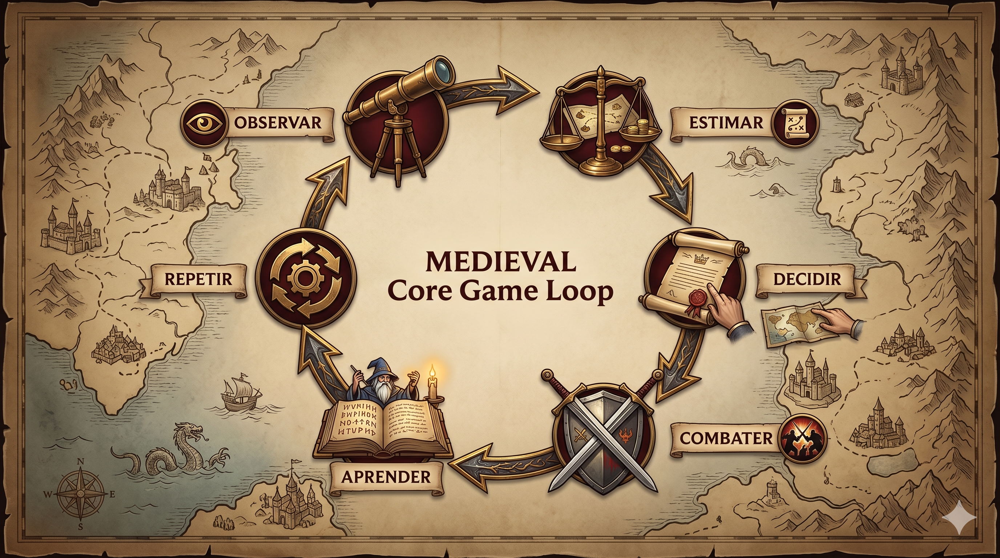

### Índice de Precisão (IP) **[v5]**

O IP é o fio pedagógico do jogo. Como o jogador **não digita estimativas** (isso viraria um exercício), ele é **derivado das decisões**. Seja *m* a margem real entre as forças, `|FJ − FI| / max(FJ, FI)`:

| Situação | IP da rodada |
|---|---|
| Decisão certa (vitória) | 100 |
| Recuo com margem < 5% (dúvida justificada) | 70 |
| Recuo com margem ≥ 5% | 40 |
| Decisão errada com margem < 5% (quase impossível de ver) | 50 |
| Decisão errada com margem < 15% | 25 |
| Decisão errada com margem ≥ 15% (diferença evidente) | 0 |

O **IP da fase** é a média das rodadas. Feedback sonoro ao final de cada rodada, sem texto de punição: IP ≥ 90 → sino cristalino curto; entre 40 e 89 → silêncio neutro; < 40 → sino grave e longo (um lembrete suave de calibração).

O IP é um retorno sobre a qualidade das decisões. **[v6] Ele não define a medalha.**

### 7.1 Medalhas, pontuação e desbloqueio **[v6]**

| Medalha (Domínio ao fim da rodada 10) | Condição | Bônus de XP |
|---|---|---|
| Sem medalha | menos de 60% — **fase perdida** | — |
| ★ **Bronze** | 60% ou mais — libera a fase seguinte | +150 |
| ★★ **Prata** | 80% ou mais | +350 |
| ★★★ **Ouro** | 100% | +600 |

Sem recuos e sem Golpe Decisivo, equivalem a 6, 8 e 10 vitórias. O Domínio fica sempre entre 0% e 100% (recuar com 0% não tira nada). Fica registrada a melhor medalha de cada fase.

**Trava de terreno.** Para entrar em um novo cenário, além de vencer a fase anterior, é preciso somar estrelas na campanha:

| Para entrar em | II · Vales | III · Serra | IV · Arquipélago | V · Abismo |
|---|---|---|---|---|
| Estrelas acumuladas | 8 | 16 | 24 | 32 |

Quando faltam estrelas, o mapa e a tela de fim de fase avisam quantas são e sugerem repetir fases.

**Pontuação da fase.** Vitória na rodada: 100 pontos, +50 por vitória consecutiva anterior e até +200 de velocidade (proporcional ao tempo que sobrou; pausa, guia e tutorial não contam). Derrota: −50 (nunca abaixo de zero). **XP = pontos + bônus da medalha.** O XP é acumulado no progresso e ainda não é gasto.

---

## 8. Progressão

A progressão não é linear — é uma pressão crescente: o reino do jogador cresce a cada conquista, tornando o cálculo da própria área mais complexo; e a diferença de tamanho entre jogador e inimigos diminui a cada fase, exigindo estimativas cada vez mais precisas.

**Calibração da dificuldade [v5].** O intervalo de diferença entre jogador e inimigo diminui linearmente de **25–35% na Fase 1** até **2–5% na Fase 20**. A diferença é medida na razão **efetiva** (Força_J / Força_I, já com o terreno aplicado); por isso, nos cenários com modificadores, a diferença *visível* de área engana — é o que obriga o jogador a calcular "para qual contexto" está decidindo. **[v6]** O tempo por rodada é fixo por cenário e foi reduzido para gerar tensão (antes: 60, 60, 60, 45 e 30 s). A Serra tem 5 s a mais porque ali a grade de referência desaparece.

| Cenário | Tempo por rodada | Diferença entre as forças | Área inicial (blocos) |
|---|---|---|---|
| I · Planícies (1–4) | 30 s | de 25–35% a 21–30% | 12–20 |
| II · Vales (5–8) | 30 s | de 20–29% a 16–24% | 20–30 |
| III · Serra (9–12) | 35 s | de 15–22% a 12–18% | 30–40 |
| IV · Arquipélago (13–16) | 30 s | de 11–16% a 7–11% | 40–55 |
| V · Abismo (17–20) | 25 s | de 6–10% a 2–5% | 50–65 |

### O reino cresce e o grid encolhe

A cada vitória o jogador anexa território dentro da fase, e a área inicial cresce de cenário para cenário. O grid mantém o tamanho da célula, e estimar fica progressivamente mais difícil: no início são 12–20 quadrados fáceis de contar; no Abismo, 50–65 em formas compostas e vazadas.

### Progressão de formas **[v5]**

| Cenário | Forma | Como o jogador conta |
|---|---|---|
| **I · Planícies** (F.1–4) | Retângulos simples com grande discrepância entre os lados. | Largura × altura. |
| **II · Vales** (F.5–8) | Retângulos com **meios-blocos** e **arestas diagonais**. | Contar inteiros e somar os meios-blocos; grade de referência de 1 célula. |
| **III · Serras** (F.9–12) | **Trapézios** e **formas compostas** (L, T, U). Sem grade de apoio. | Decompor e somar partes. |
| **IV · Arquipélagos** (F.13–16) | Figuras **complexas e preenchidas** com bordas diagonais. 30 s por rodada. | Decomposição sob pressão de tempo. |
| **V · Abismo** (F.17–20) | Malhas **vazadas** — blocos ausentes no interior. 25 s por rodada. | Subtração de áreas; relevo misto; Fase 20 com morte súbita. |

**[v6]** A cada cenário, uma lição curta apresenta o atalho de cálculo das novas formas. Aplicá-lo sob pressão de tempo é o que consolida a geometria.

### A caminhada não é fácil

Nos primeiros cenários a diferença é ampla e absorve erros grosseiros. Com o avanço, essa margem desaparece e os modificadores de terreno passam a ter peso decisivo: um inimigo levemente menor em Serra (×1,25 na defesa) pode ser, na prática, maior. Saber calcular deixa de ser suficiente; é preciso saber para qual contexto se está calculando.

### Por que os arquétipos são essenciais na progressão

- **Engenheiro:** com o reino crescendo e a diferença diminuindo, a Consolidação reduz o custo dos erros ao atacar, e a Muralha de Emergência vira um seguro nos cenários de Serra em diante.
- **Guerreiro:** o Embalo de Combate é poderoso nas sequências longas, mas perder uma batalha zera o bônus. O Golpe Decisivo deve ser usado cirurgicamente, onde a estimativa é confiante — nunca como aposta.
- **Estrategista:** essencial quando a grade ao redor do inimigo some (Serras em diante). O Olho de Águia devolve parte do referencial; a Análise de Campo confirma a estimativa antes de uma decisão de alto risco.

---

## 9. Personagens

### História

No continente de Geometria, os reinos existem há séculos em equilíbrio frágil — cada um definido pela forma precisa de seu território e protegido pelas Leis da Forma. O equilíbrio se rompe quando o Grande Império das Formas Irregulares começa a absorver os reinos vizinhos, violando os tratados geométricos.

Você é o **Arquiteto-Rei**, herdeiro de um pequeno reino retangular nas Planícies de Aldrath. Seu reino é modesto, mas sua mente é afiada. Para sobreviver e contra-atacar, você precisa entender o que seus inimigos jamais compreenderam: a área de um território é sua maior arma.

### Elenco

- **O Arquiteto-Rei (jogador).** Jovem soberano, inteligente mas inexperiente. Seu arco é aprender, por necessidade, a pensar geometricamente em cada decisão de guerra.

  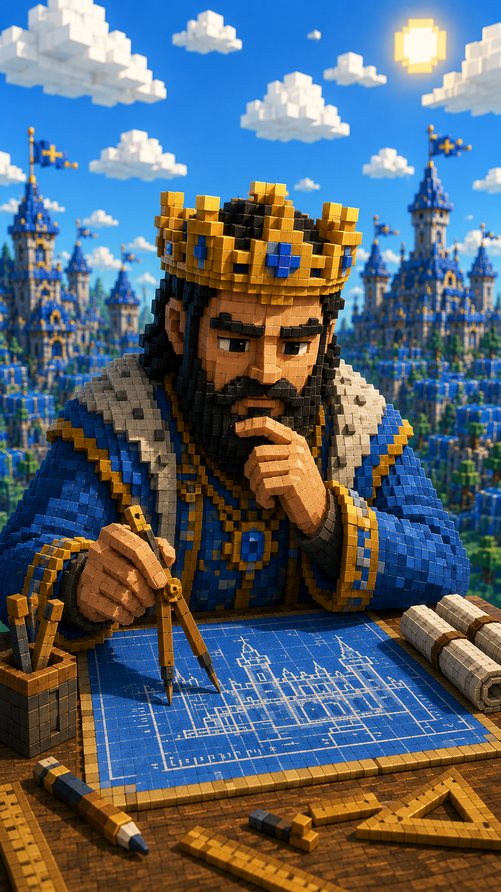

- **A Cartógrafa (narradora e guia).** Anciã sábia que guia o jogador pelas fases iniciais com dicas contextuais. Voz calma, quase acadêmica, mas nunca didática.

  

- **Os Reinos Rivais (antagonistas).** Cada reino tem nome e personalidade geométrica. O Reino de Aldrasq é perfeitamente quadrado e orgulhoso de sua simetria. O Ducado de Kermith é um retângulo irregular expansionista. O **Império das Formas** é o vilão final — territórios caóticos que desafiam qualquer cálculo simples.

**[v6]** Cada uma das 20 fases tem um rival com nome e provocação própria (§11.1).

**Conflito central:** expandir o reino através de cálculo preciso enquanto o Império das Formas cresce caoticamente.

---

## 10. Mundo e Level Design

Geometria é o continente onde o jogo se passa — um mundo medieval-fantástico cujas fronteiras foram seladas pelas "Leis da Forma". A força de um reino vem da extensão de seu território. O continente tem 5 regiões, cada uma com atmosfera, arquitetura e formas próprias.

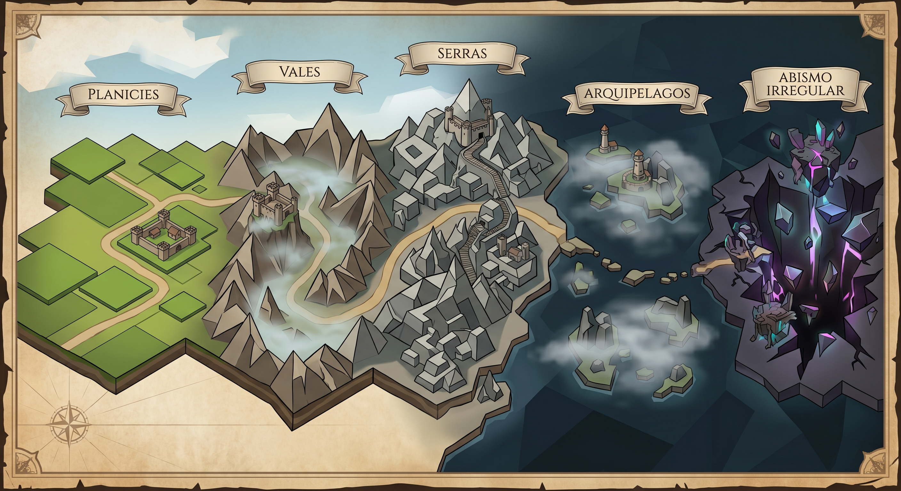

| # | Cenário | Fases | Terreno | Formas | Grade de referência | Tempo | Cartógrafa | Unidade |
|---|---|---|---|---|---|---|---|---|
| I | **Planícies de Aldrath** | 1–4 | Plano | Retângulos | Total | 30 s | Ativa | m² |
| II | **Vales de Kheldorn** | 5–8 | Vale | Meios-blocos e diagonais | 1 célula | 30 s | Ativa (5–6), silenciosa (7–8) | m² → km² |
| III | **Serra das Pedras Vivas** | 9–12 | Serra | Trapézios e compostas | Nenhuma | 35 s | Silenciosa (9), ausente (10+) | km² |
| IV | **Arquipélago do Oblívio** | 13–16 | Costeiro | Complexas e preenchidas | Nenhuma | **30 s** | Ausente | ha |
| V | **Abismo Irregular** | 17–20 | Misto | Malhas vazadas | Nenhuma | **25 s** | Ausente | ha |

- **I — Planícies de Aldrath.** Campos abertos, castelos de pedra simples com torres quadradas. Atmosfera de amanhecer medieval quente e acolhedora.
- **II — Vales de Kheldorn.** Vales profundos, pontes de pedra, fortalezas sobre penhascos. Névoa matinal nas montanhas; tom mais sombrio.
- **III — Serra das Pedras Vivas.** Floresta densa com castelos entre as árvores. Tom verde-escuro e opressivo. A Cartógrafa desaparece na fase 10.
- **IV — Arquipélago do Oblívio.** Ilhas conectadas por pontes de cristal. Azuis profundos e roxos — atmosfera onírica.
- **V — Abismo Irregular (o teste final).** Ruínas de uma civilização geométrica. Tom monocromático chumbo e dourado. **Fase 20: morte súbita** — errar uma decisão encerra a fase imediatamente.

**[v6]** As atmosferas acima são a meta de arte. No protótipo, cada cenário tem uma textura própria de pergaminho no campo de batalha.

### Arquitetura dos castelos *(futuro)*

Cada reino rival tem um castelo cuja silhueta reflete sua personalidade geométrica: o Reino do Quadrado tem quatro torres idênticas; o Reino das Formas Compostas tem anexos irregulares e assimétricos. O jogador aprende a "ler" o inimigo pela arquitetura antes mesmo de ver o território.

---

## 11. Narrativa

**Contexto.** No continente de Geometria, a força de um reino não é medida por exércitos, mas pela extensão e precisão de seu território. Durante séculos, as Leis da Forma mantiveram o equilíbrio: toda disputa era resolvida pela comparação de áreas, não pelo derramamento de sangue.

**História principal.** O Grande Império das Formas Irregulares absorve reinos vizinhos, violando os tratados. Seus territórios são intencionalmente deformados — polígonos caóticos — tornando impossível aos reinos menores calcular sua força antes de um confronto. Guiado pela Cartógrafa, o Arquiteto-Rei parte em campanha pelos cinco cenários, enfrentando dez reinos por fase. Cada vitória expande seu território; cada derrota encolhe as fronteiras que jurou proteger.

**Linha do tempo da campanha:** Planícies (retângulos simples) → Vales (meios-blocos e diagonais) → Serra (trapézios e compostas) → Arquipélago (complexas) → Abismo (vazadas).

**Como a história aparece no jogo:** prólogo na primeira visita ao mapa; um capítulo com lição de cálculo ao chegar a cada cenário (a partir da Serra, como anotações deixadas pela Cartógrafa); um rival com provocação própria em cada fase; e o desfecho na tela de fim de fase. As cenas podem ser puladas e revistas pelo guia *Como jogar*.

**Papéis:** o Arquiteto-Rei (do medo ao domínio); a Cartógrafa (guia os Cenários I e II e se cala até desaparecer, simbolizando a autonomia conquistada); o Império das Formas (caos geométrico a ser superado).

### 11.1 Roteiro no jogo **[v6]**

**Prólogo (4 cenas):** O Continente de Geometria · O Império das Formas · O Arquiteto-Rei · Sua Campanha.

**Capítulos (2 cenas cada: situação e lição de cálculo):**

| Capítulo | Voz | Lição |
|---|---|---|
| I · Planícies | A Cartógrafa | Retângulo |
| II · Vales | A Cartógrafa | Meios-blocos |
| III · Serra | Despedida e anotação da Cartógrafa | Trapézios e formas compostas |
| IV · Arquipélago | Anotação da Cartógrafa | Dividir para somar |
| V · Abismo | Última carta da Cartógrafa | Subtrair os vazios |

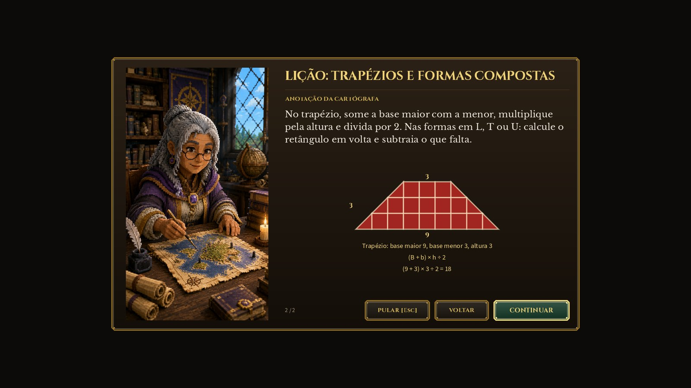

**Rivais:**

| Fase | Rival | Provocação |
|---|---|---|
| 1 | Reino de Aldrasq | *"Meu reino é um quadrado perfeito. O seu é só um rascunho."* |
| 2 | Ducado de Kermith | *"Cresci um lado de cada vez. Adivinhe qual."* |
| 3 | Baronato do Campo Longo | *"Sou comprido. Comprido não quer dizer grande... ou quer?"* |
| 4 | Condado da Torre Alta | *"Olhe para cima, Arquiteto. A altura também conta."* |
| 5 | Senhorio do Penhasco | *"Cortei os cantos das minhas muralhas. Conte as metades, se puder."* |
| 6 | Marquesado da Névoa | *"No vale, quem defende vale mais."* |
| 7 | Principado da Ponte Quebrada | *"Cada canto que falta é uma armadilha."* |
| 8 | Fortaleza de Kheldorn | *"Ninguém toma o vale pelo tamanho que aparenta."* |
| 9 | Clã da Pedra Inclinada | *"Duas bases, uma altura. Esqueça uma delas e caia."* |
| 10 | Guarda das Raízes | *"Sem malha para contar. E a sua Cartógrafa, onde está?"* |
| 11 | Irmandade do Machado | *"Meus anexos crescem para onde você não olha."* |
| 12 | Rei da Serra Viva | *"Na serra, atacar custa caro. Tem certeza das suas contas?"* |
| 13 | Ilha das Marés | *"A maré sobe depressa. Decida depressa."* |
| 14 | Corsários do Cristal | *"Minhas costas não têm linha reta. Boa sorte."* |
| 15 | Arquiduquesa do Oblívio | *"Quem hesita aqui é esquecido."* |
| 16 | Almirantado Sem Nome | *"Atacar compensa no meu litoral. Será que compensa hoje?"* |
| 17 | Vigia das Ruínas | *"O que falta por dentro também se mede."* |
| 18 | Arauto das Formas | *"O terreno muda a cada rodada. Suas certezas também."* |
| 19 | Guardião Vazado | *"Sou feito de buracos. Subtraia, se tiver coragem."* |
| 20 | Império das Formas Irregulares | *"Um único erro, Arquiteto, e seu reino será nosso."* |

**Desfechos de cenário:**

- **I · Planícies:** As Planícies de Aldrath estão livres! Camponeses hasteiam sua bandeira. Ao norte, as fortalezas de Kheldorn pedem socorro.
- **II · Vales:** Os Vales de Kheldorn juram lealdade. A Cartógrafa sorri em silêncio: você já mede sem precisar ouvi-la.
- **III · Serra:** A Serra das Pedras Vivas se rendeu — e você a venceu sozinho. Do alto, avistam-se as ilhas do Oblívio.
- **IV · Arquipélago:** O Arquipélago se lembra do seu nome. Resta apenas o Abismo, onde o Império nasceu.
- **V · Abismo (final):** O Império das Formas caiu! As Leis da Forma voltam a reger Geometria. No último pergaminho, a Cartógrafa escreveu: “Você nunca precisou de mim para medir. Só para acreditar.”

Nas demais fases, a vitória diz que o rival passou a fazer parte do reino; a derrota, que ele resiste, e convida a revisar os cálculos.

---

## 12. Interface (UI)

Direção visual: bordas douradas, couro e pergaminho, tipografia Cinzel / Libre Baskerville / Source Sans 3.

**Fluxo:** Título → Menu → (prólogo na primeira visita) Mapa → (capítulo na primeira visita ao cenário) Briefing → Batalha → Fim de fase.

### Tela de título **[v6]**

Brasão, título dourado com brilho, brasas animadas e "Pressione qualquer tecla" (a introdução pode ser pulada).

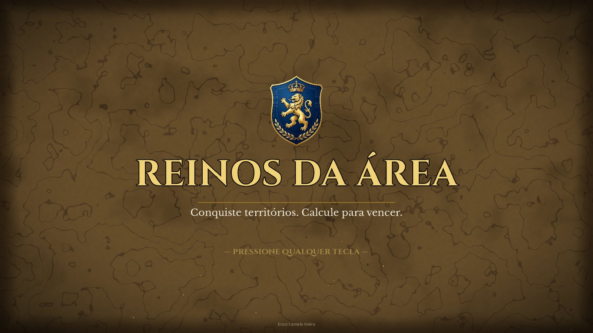

### Menu principal **[v6]**

**Continuar** (quando há progresso; avisa se faltam estrelas) · **Jogar Campanha** · **Conselheiro** · **Mapa de Cenários** · **Como Jogar** · **Opções** · **Sair**.

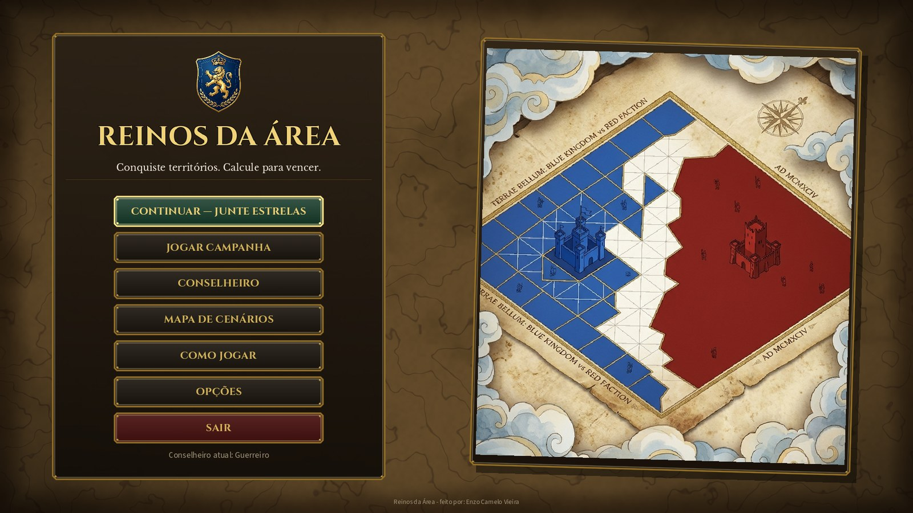

### Seleção de arquétipo

Três cartões com passiva, ativa, custo em RE e objetivo.

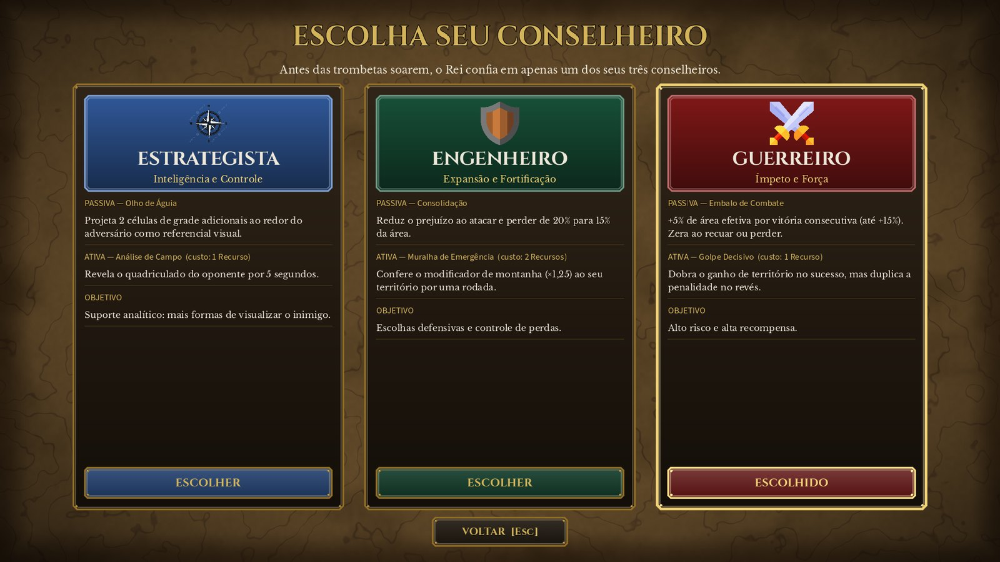

### Mapa de campanha **[v6]**

Mapa ilustrado com 20 selos de cera ligados por uma trilha. As fases 1–16 seguem a estrada e as pedras do mar; as fases 17–20 ficam nas **pedras flutuantes do Abismo**, ligadas por arcos de salto. O selo mostra número, estrelas ou cadeado, e a fase atual pulsa. O trecho liberado da trilha fica dourado. No topo: conselheiro, total de estrelas, RE, **Como Jogar** e **Trocar**.

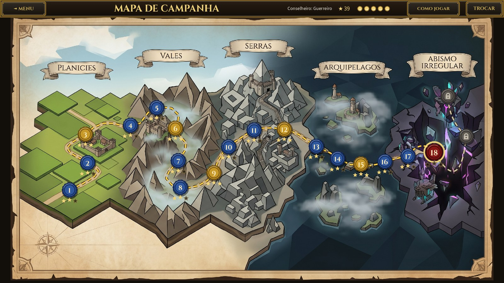

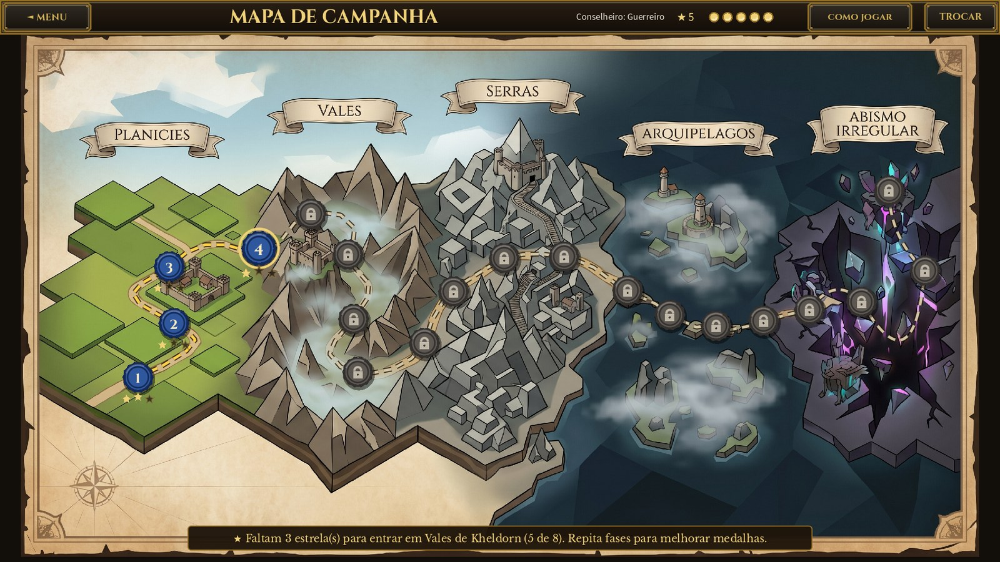

### Briefing da fase **[v6]**

Rival e provocação, terreno, tempo, formas, grade de referência, unidade, Cartógrafa, objetivo, melhor medalha e precisão, critérios das medalhas e conselheiro. Botões: **Voltar**, **História**, **Trocar conselheiro**, **Iniciar fase**.

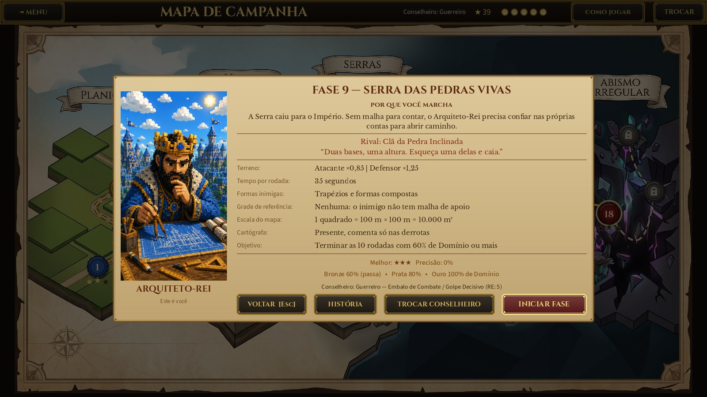

### Tela de jogo — HUD principal **[v6]**

- **Barra superior:** área total (na unidade da fase), barra de Domínio com bandeira nos 60% e marca nos 80%, 10 escudos com o histórico das rodadas, cenário, fase e terreno.
- **Sobre o campo:** faixas com os multiplicadores de cada reino, relógio circular ao centro (vermelho, pulsando e com batidas de guerra nos últimos 10 s) e botão **Como Jogar [H]**.
- **Painel inferior, esquerda (Conselho de Guerra):** terreno, sequência, pontos, seu ataque, defesa inimiga e Precisão.
- **Painel inferior, centro:** linha de meta (quantas vitórias faltam para a próxima medalha, ou aviso de meta fora de alcance) e botões **ATACAR [A] · DEFENDER [D] · RECUAR [R]**; após a rodada, **Ver relatório [V]** e **Próxima rodada**.
- **Painel inferior, direita:** arquétipo, passiva, RE e habilidade ativa **[E]**.
- **Cartógrafa:** balão de fala sobre o mapa, conforme a fase (clique para dispensar).

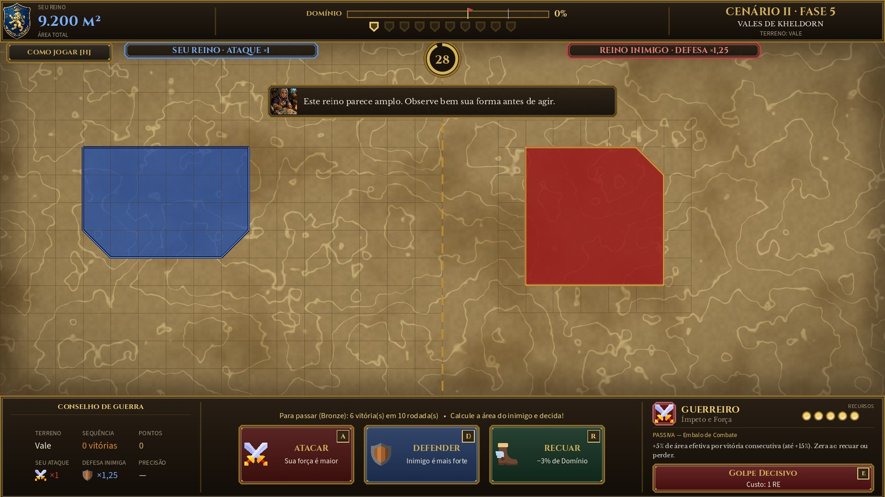

### Tela de fim de fase **[v6]**

"Crônica da batalha": medalhas que se acendem em sequência, o que falta para a próxima, Domínio final, Precisão, XP, vitórias/derrotas/recuos, motivo da derrota, recompensa (XP e RE), desfecho da história e aviso de trava. Botões: **Repetir Fase**, **Próxima Fase** (quando liberada) e **Mapa**.

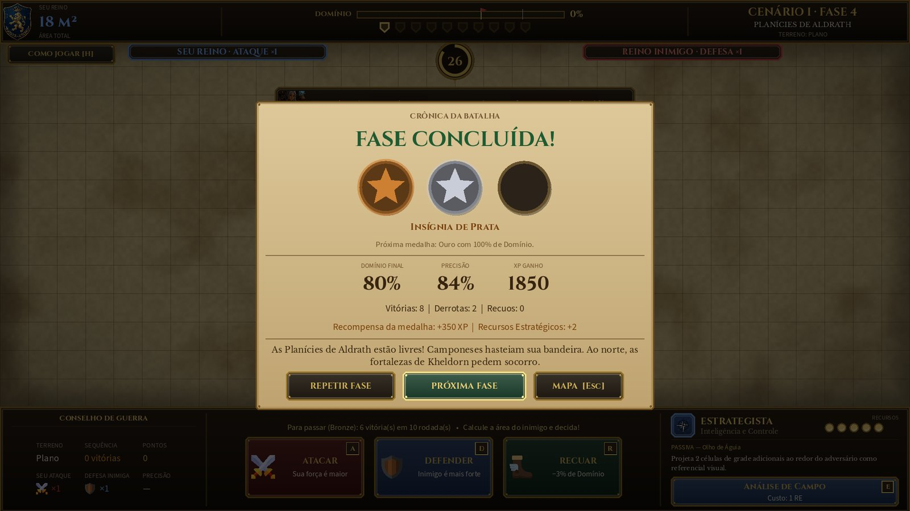

### Tutorial **[v6]**

Na primeira vez na Fase 1, a Cartógrafa conduz 6 passos com destaque na tela e opção de pular: seu reino; o reino inimigo; as três ações; o relógio e o custo dos erros; a meta e o relatório; a habilidade e o guia. O relógio fica parado.

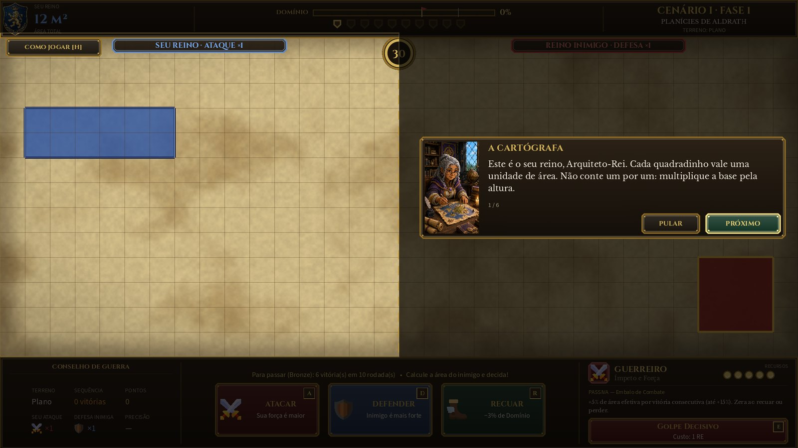

### Guia "Como Jogar" **[v6]**

Disponível no menu, no mapa, na pausa e pela tecla **H** (relógio parado). Abas: Objetivo · A rodada · Calcular áreas · Terreno e habilidades · Medalhas · Controles. Permite rever a história e o tutorial.

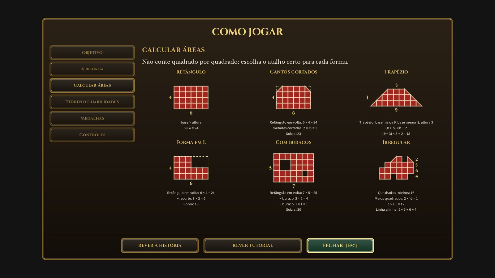

### Pausa e opções **[v6]**

**Pausa** (Esc; relógio parado): Continuar, Como Jogar, Opções e Abandonar fase (com confirmação). **Opções:** volume de música e de efeitos, tela cheia (em janela, mantém 16:9), reduzir movimento (sem tremor, com menos partículas) e reiniciar progresso (com confirmação).

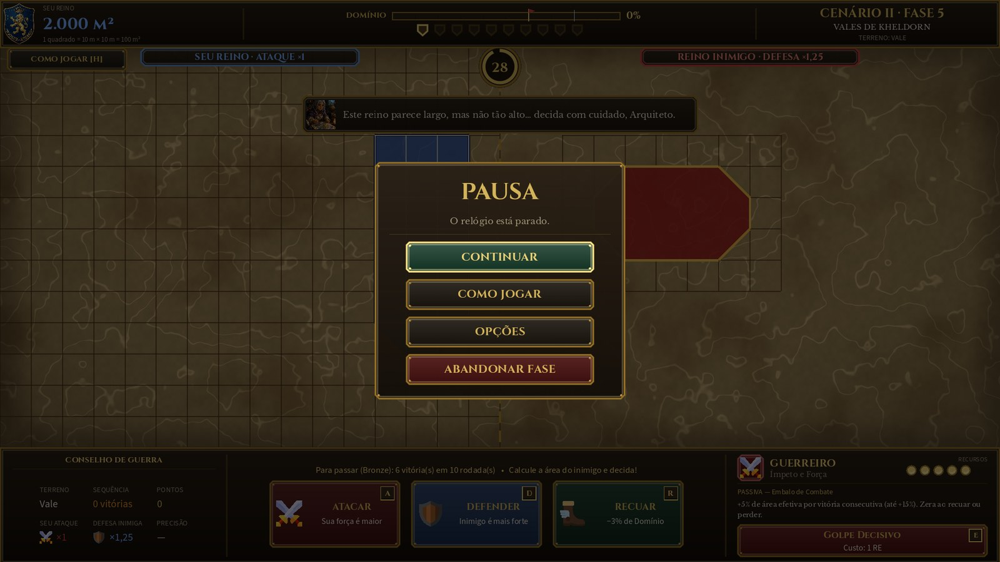

### Controles **[v6]**

| Tecla | Ação |
|---|---|
| **A / D / R** | Atacar / Defender / Recuar |
| **E** | Ativar habilidade |
| **H** | Abrir o guia na batalha |
| **V** | Esconder ou mostrar o relatório |
| **Enter / Espaço** | Próxima rodada e confirmar botão em foco |
| **Esc** | Pausar na batalha; voltar ou fechar nos menus; mapa no fim da fase |
| **Setas** | Navegar por botões e selos |

O jogo também funciona só com o mouse.

### Salvamento **[v6]**

Automático e local (`user://reinos_save.cfg`): conselheiro, fases liberadas, medalhas, melhor precisão, RE, XP, tutorial e cenas já vistos, volumes, tela cheia e reduzir movimento.

---

## 13. Direção de Arte

### Estilo visual

A estética nasce da intersecção entre a cartografia medieval iluminada do século XIII — bordas douradas, pergaminhos texturizados, caligrafia serifada — e o design limpo e legível de estratégias modernas como *Into the Breach* e *Slay the Spire*. O resultado parece antigo, mas funciona como contemporâneo.

O mapa é o protagonista visual. Fronteiras são traços dourados. A transição entre territórios conquistados e não conquistados é uma animação de "tinta se espalhando" pelo pergaminho.

### Castelos e arquitetura medieval *(meta futura)*

Cada reino possui um ícone de castelo estilizado em pixel art. O castelo do jogador começa como um humilde *keep* normando e evolui com o reino: torres surgem, muralhas se expandem, bandeiras aparecem nas ameias. Os castelos rivais refletem a personalidade geométrica de cada reino.

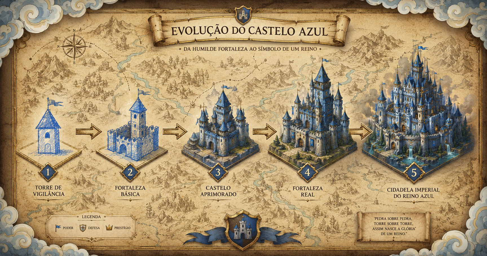

*(A evolução visual do castelo é meta de arte futura; o protótipo v0.2 usa o brasão estático.)*

**[v6] Implementado no protótipo:** interface de couro, ouro e pergaminho desenhada por código; um pergaminho com textura própria para cada cenário (shader); cursores temáticos; Cartógrafa e mapa ilustrados.

### Tipografia

| Uso | Fonte |
|---|---|
| Display / Títulos | **Cinzel** |
| Corpo / textos narrativos | **Libre Baskerville** |
| Interface / HUD | **Source Sans 3** |

### Princípios de animação

- **Conquista:** tinta azul se espalha pelo novo território (0,6 s, ease-out).
- **Derrota:** borda vermelha pulsante por 2 s.
- **Revelação:** grid aparece sobre o inimigo com efeito de "desenho à mão" (0,4 s).
- **Castelo:** animação de construção ao atingir novo nível de área *(futuro)*.

**Referências:** Civilization VI · Risk · Territorial.io · War · Clash of Clans · Into the Breach · Crusader Kings.

---

## 14. Animações

Como não há personagens com locomoção livre, a lista cobre territórios, castelo, UI e retratos. Todas as animações principais são **procedurais** (código/Tween), sem sprite sheets.

| Animação | Objeto | Descrição | Duração | Prioridade | Estado |
|---|---|---|---|---|---|
| Idle retrato | Cartógrafa | Leve respiração e piscar no retrato | Loop 2,5 s | Baixa | Futuro |
| Idle castelo | Castelo do jogador | Bandeira ondulando, fumaça nas torres | Loop 3 s | Baixa | Futuro |
| Seleção de território | Reino inimigo | Borda dourada pulsante | Loop 0,8 s | Alta | ✅ |
| Conquista | Território | Tinta azul se espalha sobre o território conquistado | 0,6 s | Alta | ✅ |
| Derrota | Território do jogador | Borda vermelha pulsante + partículas "X" | 2 s | Alta | ✅ |
| Recuo | Mapa | Linhas de vento varrem o mapa | ~1 s | Média | ✅ |
| Revelação de grid | Território inimigo | Grid surge com efeito de "desenho à mão" e fica até a próxima rodada | 0,4 s | Alta | ✅ |
| Entrada do inimigo | Território inimigo | Surge por varredura de colunas entre rodadas | ~0,9 s | Média | ✅ |
| Evolução do castelo | Castelo do jogador | Novas torres/muralhas | 1,2 s | Média | Futuro |
| Uso de habilidade | Botão de arquétipo | Brilho dourado no botão (ou vibração vermelha sem recursos) e aviso na tela | 0,5 s | Média | ✅ |
| Transição de fase | Mapa / tela | Pergaminho "vira a página" | 0,9 s | Média | ✅ |
| Menu → campanha | Tela | Pergaminho se desdobra | 0,9 s | Média | ✅ |
| Conquista de estrela | Fim de fase | Estrelas preenchem com brilho sequencial | 1,5 s | Baixa | ✅ |
| Abertura **[v6]** | Tela de título | Brasão desce, título brilha, brasas sobem | ~3 s | Média | ✅ |
| Início de rodada **[v6]** | Campo | Símbolo "VS" desce ao centro | ~1 s | Baixa | ✅ |
| Resultado **[v6]** | Campo e HUD | Selo VITÓRIA/DERROTA/RECUO, valores flutuantes, tremor na derrota | ~1 s | Alta | ✅ |
| Cenas e janelas **[v6]** | História, briefing, relatório, fim de fase | Texto que se escreve, pergaminho que se desenrola, entrada suave | 0,2–2 s | Média | ✅ |
| Mapa **[v6]** | Selos | Pulso na fase atual e realce ao focar | Loop | Média | ✅ |
| Hover/press de botão | Botões | Realce dourado ao passar o cursor (troca imediata de estilo; sem interpolação ainda) | 0,15 s (meta) | Baixa | ⚠️ parcial |

---

## 15. Áudio

O design de áudio segue a mesma filosofia: medieval por estética, moderno por função. O jogador deve entender o estado do jogo mesmo de olhos fechados.

- **Trilha sonora.** Orquestra de câmara medieval: alaúde e violas de gamba na exploração; percussão crescente de tambores durante a análise; fanfarra de trompas nas vitórias; melodia descendente nas derrotas. Meta: tema próprio por cenário *(futuro; o protótipo usa uma trilha única)*.
- **Efeitos sonoros [v6].** No protótipo: desenrolar do mapa e virar de página; sons próprios para atacar, defender e recuar; sons de vitória, derrota e vento; passagem e clique nos botões; "batidas de guerra" nos últimos 10 s; sinos de precisão (também no acender das medalhas); músicas de resumo para vitória e derrota na fase. Os sinos e o som de página são provisórios, gerados por código.
- **Ambientação sonora** *(futuro)*: vento e pássaros nas Planícies; eco de montanha nos Vales; folhagem na Serra; ondas no Arquipélago; quase silêncio no Abismo.
- **Narrativa sonora da Cartógrafa** *(futuro: voz)*. Deve soar como uma avó sábia, nunca como uma professora. Exemplos usados hoje em texto:
  - *"Este reino parece largo, mas não tão alto… decida com cuidado, Arquiteto."*
  - *"Você era maior do que pensava. Da próxima vez, compare com mais calma antes de se defender."*
- **Infraestrutura [v5].** `AudioManager` (autoload) com buses **Music** e **SFX** independentes e volumes salvos no progresso.

### Feedback sonoro da precisão

| Faixa | Som |
|---|---|
| IP da rodada ≥ 90 | Sino cristalino, curto e agradável. |
| 40 ≤ IP < 90 | Silêncio neutro — o jogador aprende visualmente. |
| IP < 40 | Sino grave e longo; lembrete suave, não punitivo. |

---

## 16. Gameplay Example **[v6]**

**Fase 15 — Arquipélago do Oblívio.** Rodada 5 de 10, **Domínio 30%** (3 vitórias e 1 derrota). Unidade: hectares. Terreno Costeiro: atacante ×1,10, defensor ×0,90. 30 segundos.

1. **Observação.** O HUD mostra "48 ha" e a meta: "Para passar (Bronze): 3 vitórias em 6 rodadas". O território do jogador tem grid; o inimigo é um polígono vermelho sem grid. A Cartógrafa está ausente.
2. **Estimativa.** O jogador divide o polígono em partes e estima cerca de 53 ha. É **maior** que o seu reino.
3. **Decisão.** Lembra que o terreno pesa: 48 × 1,10 = 52,8 contra 53 × 0,90 = 47,7. Escolhe **ATACAR**.
4. **Resolução.** A tinta azul se espalha. Domínio de 30% para 40%; área +10%.
5. **Revelação e relatório.** O grid aparece sobre o inimigo e o popup mostra os dois cálculos lado a lado. Precisão da rodada: 100.

**O aprendizado.** O inimigo era maior em área e mais fraco em força: o contexto (terreno) pondera a área. A decomposição usada na estimativa é conferida no relatório.

---

## 17. Tema e Aspecto Sério

**Tema abordado.** Geometria plana aplicada à estimativa de área: raciocínio espacial e estimativa visual sem exercícios formais, mais **unidades de medida de área** (m², km², hectares). A progressão parte de retângulos (Cenário 1) e avança para meios-blocos e diagonais (2), trapézios e compostas (3), complexas (4) e malhas vazadas (5).

**Como aparece no jogo.** Calcular área equivale a ter poder militar; errar a estimativa significa perder território. O jogador estima, age, erra e aprende pela revelação pós-combate — e na próxima situação análoga estima melhor. **[v6]** Para orientar quem não conhece os atalhos, o jogo nomeia as formas e mostra os cálculos nas lições, no guia e no relatório, sempre dentro da ficção e fora do momento da decisão.

**Aprendizado pela necessidade.** O jogador usa largura × altura porque precisa disso para vencer. Em formas compostas pratica decomposição; nas vazadas, subtração de áreas. Com os modificadores de terreno, desenvolve raciocínio proporcional.

| Integração aprendizado × gameplay |
|---|
| Raciocínio geométrico emerge por necessidade estratégica |
| Erros têm consequência emocional e visual imediata |
| O Índice de Precisão quantifica a evolução |
| A revelação pós-combate fecha o ciclo de aprendizagem |
| Terreno e escalas de medida introduzem raciocínio proporcional |
| Nenhuma tela de exercício explícito, nenhuma linguagem de "resposta errada" |

**Princípio central:** o jogo nunca pode funcionar como uma prova disfarçada.

**Literatura de jogos sérios.** O design segue a aprendizagem baseada em jogos (Gee, 2003): contexto significativo, consequência das ações e ciclos de feedback imediato. A progressão — de formas regulares a polígonos irregulares sob pressão de tempo — respeita a Teoria da Carga Cognitiva (Sweller, 1988), introduzindo complexidade somente quando a habilidade anterior está consolidada.

---

## Apêndice A — Histórico de versões

### Da v4 para a v5

| Tema | v4 | v5 |
|---|---|---|
| Arquétipos | Fortificações/Espólios, Legião de Cativos/Aço Duplo, Infiltração Noturna/Cartografia Roubada | Consolidação/Muralha, Embalo/Golpe Decisivo, Olho de Águia/Análise de Campo, com custo em RE |
| Terrenos | Plano, Serra, Costeiro | Acrescenta **Vale** e o relevo **Misto** do Abismo |
| Formas | Quinas irregulares → L/T → diagonais → polígonos de até 12 lados | Meios-blocos/diagonais → trapézios e compostas → complexas → malhas vazadas |
| Fim de fase | "Domínio ≥ 70% ao final das 10 rodadas" com Prata "≤ 60% das rodadas" (inconsistente) | Sempre 10 rodadas; Prata = 70% até a rodada 6 |
| Índice de Precisão | Descrito sem fórmula | Derivado das decisões (tabela em §7) |
| Unidades | u² | m², km², hectares |
| Telas | Wireframes | Menu, arquétipo, mapa, fim de fase e tutorial implementados |
| Recuo | −3% de Domínio (GDD) / −5% de área (protótipo v0.1) | −3% de Domínio, sem perda de área |

### Da v5 para a v6 (após avaliação com jogadores)

| Tema | v5 | v6 |
|---|---|---|
| Medalhas | Bronze: 70% de Domínio; Prata: 70% até a rodada 6 (inalcançável sem Golpe Decisivo); Ouro: IP ≥ 85% sem derrotas | Domínio final: 60% / 80% / 100%; abaixo de 60% a fase é perdida |
| Desbloqueio | Vencer a fase anterior | Também exige 8, 16, 24 e 32 estrelas para os novos terrenos |
| Recompensa | XP + 100 por estrela; +1 RE por fase nova | XP +150/350/600; +1 RE por medalha nova |
| Tempo por rodada | 60/60/60/45/30 s | 30/30/35/30/25 s |
| Resultado da rodada | Texto no rodapé | Popup com os dois reinos lado a lado e o cálculo |
| Orientação | Tutorial de 5 passos | Tutorial de 6 passos, guia Como Jogar e linha de meta |
| História | Descrita no documento | Prólogo, capítulos com lições, 20 rivais e desfechos no jogo |
| Análise de Campo | Área real e grid | Só o grid |
| Mapa | Cinco colunas de fases | Trilha sobre o mapa ilustrado e saltos nas pedras do Abismo |
| Seleção de arquétipo | Cartão sobe ao passar o mouse | Sem efeito de hover no cartão |

## Apêndice B — Estado do protótipo **[v6]**

- **Tecnologia:** Godot 4.6 (GDScript), renderizador Compatibility, resolução base 1920 × 1080. Distribuído e testado no Windows.
- **Testes automáticos:** regras, gerador de territórios, explicação das áreas e fases completas.
- **Ainda não implementado:** evolução do castelo, arquitetura própria dos castelos rivais, trilha e ambientação por cenário, voz da Cartógrafa e versão Web.
- **A validar com jogadores:** os novos tempos de rodada e a dificuldade do Ouro (100%).
